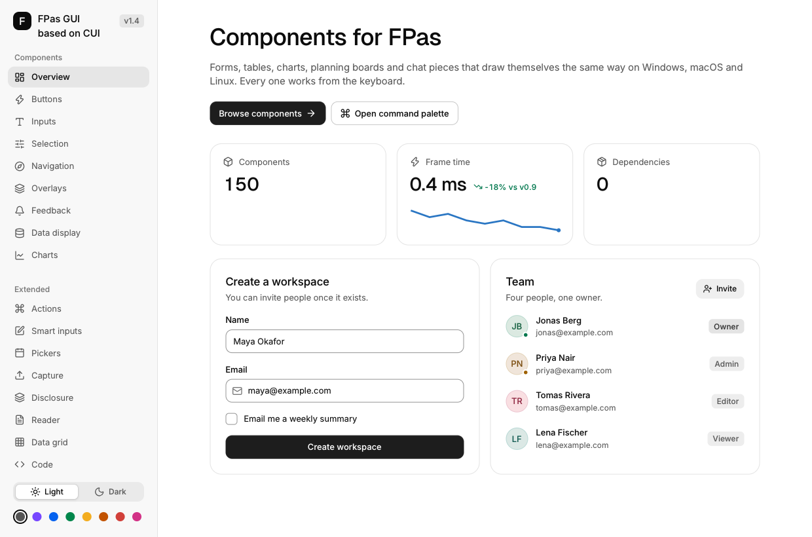

# Functional Pascal for .NET

A function-first Pascal language with selected Ada conventions. Compiles `.fpas`
sources directly to CIL and CLR assemblies, running through the .NET host.

> **⚠️ Disclaimer:** This is a small hobby project, entirely vibe-coded. It started as an experiment in learning how to effectively communicate and collaborate with LLMs. The future is uncertain — no idea where this will end up, or if it will.
>
> I switched the implementation from Rust to C# partly because Rust's build times were getting on my nerves. The biggest reason, though, was the .NET ecosystem. We can use .NET libraries through NuGet instead of writing and maintaining wrappers ourselves.
>
> I'm still surprised by how much the models have improved in just a year, and by how far they managed to take the Rust version. Maybe we'll switch back to Rust in a year or two if the models improve enough. That also depends on whether I'm still interested in the project by then.
>
> What happens next with the game, Into the Dungeon, is uncertain too.

[](LICENSE)

## Features

- **Function-first** — Free functions and procedures are the primary building blocks, with immutable records and variants for data.
- **Explicit binding mutability** — `const` prevents rebinding; `var` permits assignment. Referenced .NET objects and array elements retain their own mutability. Managed `ref`, `out`, and `in` modes make caller-storage access explicit.
- **Pattern matching** — Exhaustive `case` statements and expressions with variant payloads, nested patterns, guards, and CLR type tests.
- **First-class functions** — Typed lambdas, named routines, and lexical helpers become ordinary CLR delegates. Mutable captures share storage; closures can outlive their declaring call.
- **Contracts** — `requires` and `ensures` check routine entry and successful exit in Debug and Release, including delegates, interfaces, and C# callers.
- **Generics** — Records, variants, and routines use CLR type parameters, `<...>` arguments, `where` constraints, and local call/variant-constructor inference.
- **Subranges and distinct types** — Checked integral bounds and nominal scalar identities, including valid CLR default values for subranges.
- **CLR nullability and exceptions** — `T?`, validation, coalescing, `try`/`catch`/`finally`, and stack-preserving rethrow. Application variants model domain outcomes.
- **Resource lifetime** — `using const` and `await using const` dispose resources when the enclosing scope exits, including exceptional exits.
- **Async and concurrency** — Task-based functions, lambdas, and programs; supported Task/ValueTask awaits, cancellation tokens, channels, and coordination through actual .NET APIs.
- **.NET interoperability** — Consume referenced classes, structs, interfaces, properties, indexers, delegates, events, and attributes. A `protocol` declares a CLR interface with generic methods, inheritance, and getter-only properties. Records can implement protocols and imported CLR interfaces.
- **.NET libraries** — Use collections, files, text, regex, JSON, networking, and other supported framework/package APIs through explicit imports.
- **Projects and tooling** — `.fpasproj` projects, mixed FPAS/C# `.slnx` solutions, portable PDBs, XML API documentation, and incremental builds through Fpas.NET.Sdk.
- **Managed execution** — The CLR supplies garbage collection, exceptions, and task infrastructure. FPAS has no pointer or manual-memory-management syntax.
- **Case-sensitive and explicitly typed** — Lowercase keywords and exact CLR names. Every value binding, parameter, result, field, and pattern binding requires its type.

Known missing baseline work and deferred extensions are listed in
[language gaps](docs/future/language-gaps.md). The
[coverage map](tests/coverage.md) identifies verified language and build behavior.

## Desktop GUI

FPas includes a declarative desktop GUI based on [CUI](https://github.com/yappologistic/CUI).
The [FPas widget gallery](examples/ui/gui/gallery/README.md) shows native controls,
layout, and themes in a Functional Pascal application.



## Quickstart

### Build from source

Install a stable .NET 10 SDK satisfying [global.json](global.json). It selects
10.0.100 or a later installed 10.0 feature band and excludes preview SDKs.
Install the [native CUI build prerequisites](src/Fpas.Ui.Gui.Cui/native/README.md#prerequisites)
for the full solution build.
From the root of this CLR checkout, build the toolchain and package its local SDK:

```sh
dotnet restore Fpas.slnx
dotnet build Fpas.slnx --no-restore --configuration Debug -warnaserror
dotnet pack sdk/Fpas.NET.Sdk/Fpas.NET.Sdk.csproj --no-build --configuration Debug --output sdk/feed
```

The compiler is `src/Fpas.Cli/bin/Debug/net10.0/Fpas.Cli.dll`. Run it through
`dotnet`; keep its output directory's dependencies together. The local SDK feed
is configured by [NuGet.Config](NuGet.Config). If you repacked an SDK version
already in your NuGet package cache, remove that version's cached package before
building the example. See the [SDK cache instructions](docs/build/development.md#build-an-fpas-application).

Build and run the checked-in example.

```sh
dotnet src/Fpas.Cli/bin/Debug/net10.0/Fpas.Cli.dll build examples/basics/hello/Hello.fpasproj
dotnet src/Fpas.Cli/bin/Debug/net10.0/Fpas.Cli.dll run examples/basics/hello/Hello.fpasproj --no-build
```

It prints `Hello from FPAS`. The
[development workflow](docs/build/development.md) describes Release builds,
tests, direct compilation, and SDK version/cache handling after toolchain changes.

For a Release compiler on PATH, run `./dist.ps1` on Windows x64 or `./dist.sh`
on Linux x64, then add the repository's `bin/` directory to PATH. The scripts
deliver one self-contained `fpas.exe` or `fpas`, including its .NET runtime and
matching SDK package. Copy only that executable; `fpas sdk export ./feed` exports
the SDK for offline project restore. See [distribution](docs/build/distribution.md).

### Hello World

With the deployed compiler on PATH, create the project and source:

```sh
fpas init project examples/my-hello --name Hello --sdk-feed sdk/feed
```

Replace its generated `main.fpas` with:

```pascal
program Hello;

uses System.Console as Console;

begin
  Console.WriteLine('Hello, World!');
end;

end program;
```

Build and run the project:

```sh
fpas build examples/my-hello/Hello.fpasproj
fpas run examples/my-hello/Hello.fpasproj --no-build
```

See [create/build/run](docs/pascal/program-structure/project-commands.md) for
library/solution templates, selection, arguments, streams and JSON reports.

### Development tools

Use [fpas doc](docs/pascal/tools/api-documentation.md) to look up FPAS declarations
and the actual .NET reference APIs, with signatures and Markdown/XML documentation.

Use [check --fix](docs/pascal/tools/diagnostics.md#apply-automatic-corrections)
for automatic diagnostic corrections; add --dry-run to preview the edit batch.

Use [refactor rename/apply](docs/pascal/tools/refactoring.md) to prepare, inspect
and explicitly apply checked symbol renames.

Portable symbols retain source locations, local scopes, closure methods, and
async yield/resume metadata. Use compatible .NET debuggers and profilers with
the generated assembly/PDB pair. See [debugging](docs/pascal/tools/debugging.md)
and [profiling](docs/pascal/tools/profiling.md).

Use [fpas fmt](docs/pascal/tools/fmt-style.md) for the fixed source style and
check/list/stdout modes. The [VS Code extension](src/VSCode/README.md) uses the
[language server](docs/pascal/tools/language-server.md) for live analysis and
provides project, test, and debug commands.

## Applications

[`apps/`](apps/README.md) contains the documentation example checker and the
diagnostic workloads for profiling and failure investigation. Focused language
and .NET API demonstrations live under [`examples/`](examples/README.md).

## Examples

Each Pascal fence below is a complete independent program using the same project
shape as Hello World. Replace the project's source with one example at a time.

### Fibonacci

```pascal
program Fibonacci;

uses System.Console as Console;

function Fib(N: int): int;
begin
  if N <= 1 then
    return N;
  else
    return Fib(N - 1) + Fib(N - 2);
  end if;
end function;

begin
  Console.WriteLine('Fibonacci sequence:');
  for I: int := 0 to 9 do
    Console.WriteLine(Fib(I));
  end for;
end;

end program;
```

### Pattern Matching

Use a closed variant for exhaustive domain alternatives. CLR enums can also contain
unnamed values and require a fallback when matched.

```pascal
program PatternMatching;

uses System.Console as Console;

type Light = variant
  Red;
  Yellow;
  Green;
end variant;

function TrafficAdvice(Value: Light): string;
begin
  return case Value of
    when Light.Red: 'Stop';
    when Light.Yellow: 'Caution';
    when Light.Green: 'Go';
  end case;
end function;

begin
  Console.WriteLine(TrafficAdvice(Light.Red));
end;

end program;
```

### Higher-Order Functions

```pascal
program HigherOrderFunctions;

uses System.Console as Console;

function Double(X: int): int;
begin
  return X * 2;
end function;

function Apply(Transform: function(int): int; Value: int): int;
begin
  return Transform(Value);
end function;

begin
  const Op: function(int): int := Double;
  Console.WriteLine(Apply(Op, 10)); // 20
end;

end program;
```

### Optional Values

Use CLR nullability for absence and application variants for domain outcomes.
There is no implicit Option/Result prelude.

```pascal
program NullableExample;

uses System.Console as Console;

function FindFirst(Items: array of int; Minimum: int): int?;
begin
  for Item: int in Items do
    if Item >= Minimum then
      return Item;
    end if;
  end for;

  return null;
end function;

begin
  for Minimum: int in [10, 100] do
    const Found: int? := FindFirst([3, 7, 15, 42], Minimum);
    if Found.HasValue then
      Console.WriteLine('Found: ' + Found.Value.ToString());
    else
      Console.WriteLine('Not found');
    end if;
  end for;
end;

end program;
```

### Parsing and Error Handling

Use the .NET Try-pattern for expected input failure. Exceptional operations use
ordinary CLR exceptions and `try`/`catch`/`finally`.

```pascal
program ParseExample;

uses System.Console as Console;

begin
  for Text: string in ['21', 'invalid'] do
    var Value: int := 0;
    if int.TryParse(Text, out Value) then
      Console.WriteLine('Doubled: ' + (Value * 2).ToString());
    else
      Console.WriteLine('Input error');
    end if;
  end for;
end;

end program;
```

### .NET API Examples

Executable projects cover
[files](examples/io/read-file/README.md), [LINQ and collections](examples/io/directory-inventory/README.md),
[records](examples/types/inventory-model/README.md), [generic variants](examples/types/generic-tree/README.md),
[events](examples/interop/events/README.md), and [JSON attributes](examples/interop/attributes/README.md).

### Tests

Write FPAS tests with native xUnit, MSTest or NUnit attributes and assertions.
`fpas init test Tests` creates a test library; `fpas test Tests/Tests.fpasproj`
builds and runs it through VSTest. See the [testing guide](docs/pascal/tools/testing.md).

`--framework mstest --runner mtp` creates a self-hosted FPAS test application.
The [diagnostic CLI](docs/pascal/tools/cli-diagnostics.md) owns trace/counter/dump
operations and runtime-failure reports; [terminal tests](docs/pascal/tools/terminal-testing.md)
exercise explicit PTY/ConPTY scripts. [JSON schemas](docs/pascal/tools/report-schemas.md)
describe their structured reports.

The xUnit suite checks compiler diagnostics, emitted metadata, actual program
execution, and mixed C#/FPAS builds. It compiles complete Pascal examples in this
README and the handbook directly from Markdown and checks their results.
See the [test overview](tests/README.md), [coverage map](tests/coverage.md), and
[documentation example conventions](docs/pascal/tools/documentation-examples.md).

### Multi-file Projects and Libraries

A `.fpasproj` selects `.fpas` sources recursively. Each source declares one program
or unit; an executable has one program plus optional units, while a library has
units and no program. Sources compile into one CLR assembly per project.

Use ProjectReference for FPAS/C# dependencies and PackageReference for .NET
libraries. Imports resolve names after those references exist. Mixed `.slnx`
solutions build through ordinary MSBuild project edges. See
[units](docs/pascal/program-structure/units.md), [projects](docs/pascal/program-structure/projects.md),
and the [multi-source example](examples/basics/units/README.md).

## Documentation

Start with the [Pascal handbook](docs/pascal/README.md) for topic navigation and
the ordered learning path. For authoring with an LLM, use the compact
[agent reference](docs/pascal/agents/README.md) and its
[maintenance guide](docs/pascal/agents/maintenance.md).

| Area | Hub |
| --- | --- |
| Getting started | [Overview and first programs](docs/pascal/getting-started/README.md) |
| Language | [Basics, types, routines, patterns, resources, async](docs/pascal/language/README.md) |
| Program structure | [Programs, units, projects, CLI, output](docs/pascal/program-structure/README.md) |
| .NET interoperability | [Members, delegates, interfaces, events, attributes](docs/pascal/interop/README.md) |
| .NET libraries | [Collections, text/regex, files, JSON](docs/pascal/libraries/README.md) |
| Tools | [Diagnostics, examples, debugging, profiling](docs/pascal/tools/README.md) |
| Formal contracts | [Syntax](docs/specs/syntax.md), [CLR mapping](docs/specs/clr-mapping.md), [MSBuild](docs/build/msbuild.md) |

Contributor references are routed by the [documentation hub](docs/README.md).
Missing baseline work and deferred proposals stay in
[language gaps](docs/future/language-gaps.md).

## Contributing

See [CONTRIBUTING.md](CONTRIBUTING.md). Start with the owning language/CLR
contract, follow [AGENTS.md](AGENTS.md) when using an agent, and use the
[development workflow](docs/build/development.md) for build/test commands.

## Project Structure

| Component | Purpose |
| --- | --- |
| `src/Fpas.Compiler` | Syntax, binding, typed lowering, CIL/metadata/PDB emission, XML documentation |
| `src/Fpas.Cli` | Compiler command line, diagnostics, and output publication |
| `src/Fpas.Build.Tasks` | Bounded compiler-process invocation and MSBuild incremental tracking |
| `src/Fpas.Core` | Small versioned language-metadata support library |
| `sdk/Fpas.NET.Sdk` | Project props/targets and packaging of the matching toolchain |
| `tests/` | Compiler, metadata, execution, documentation, and SDK verification |
| `examples/` | Focused executable FPAS/.NET projects |
| `apps/` | Documentation checker and diagnostic workloads written in FPAS |

See [compiler architecture](docs/architecture/README.md) for project dependencies,
closures, async lowering, and debug metadata. The CLR owns execution and GC.

## Status

**Experimental.** The language, compiler, and SDK are under active development.
Compatibility and implementation history are not project goals. Syntax changes
require explicit approval; known requirements and proposals remain documented
separately from implemented behavior.

## License

[BSD-3-Clause](LICENSE).
