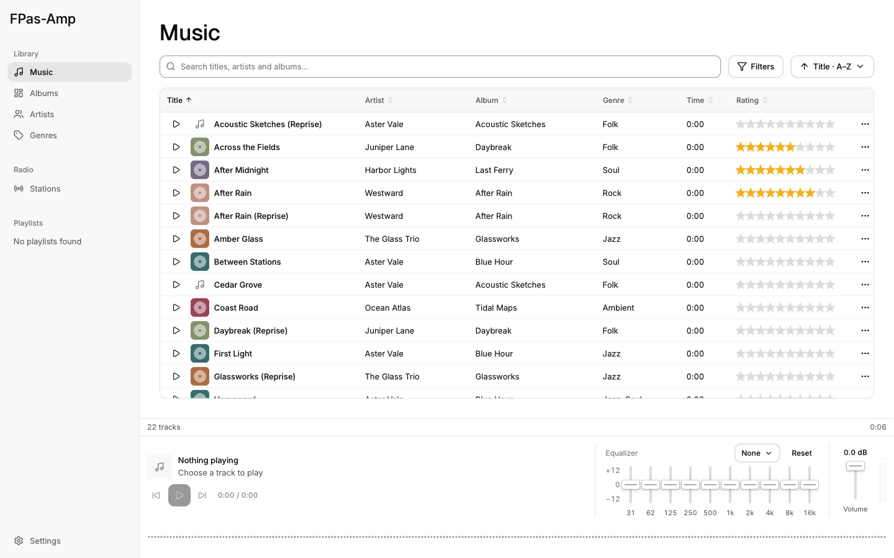
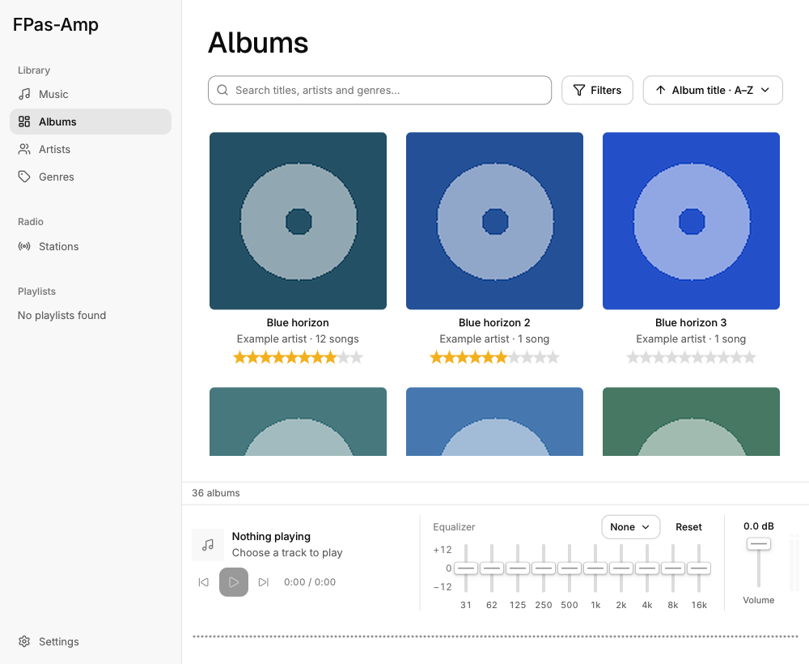
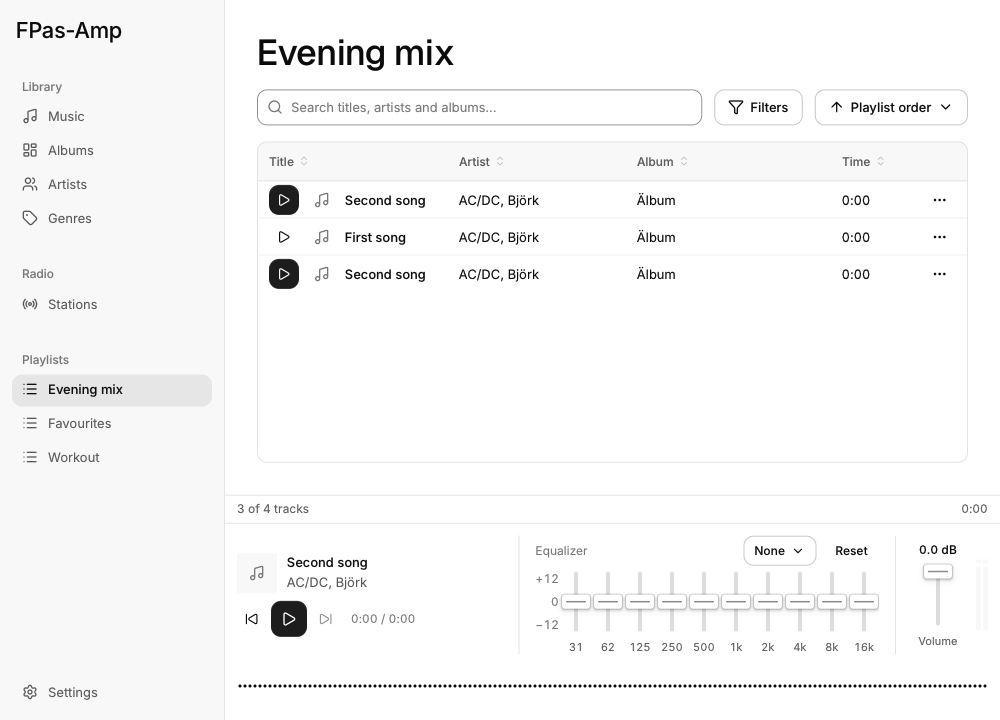

# Music library and playlists

The **Library** section contains **Music**, **Albums**, **Artists** and
**Genres**. On narrow windows, the navigation moves into a drawer. Open it
with the menu button, then choose a destination.

## Music

**Music** lists indexed tracks across all sources, with artwork, artist, album,
genre, duration and rating. Search by title, artist or album. **Filters** offers
artist, album and genre choices that narrow the list. Album choices distinguish
releases that share a title. Pick a minimum rating or **Unrated only**. Click a
sortable column or use the sort menu to change the order. The table follows
library updates during a scan.

When a catalogue refresh removes a choice from a filter menu, that selection
clears automatically. The other selections stay active.

The status bar shows the number of entries and, for tracks, their combined
duration. A search, filter or collection shows the displayed count against
the library total. For example, if a discography shows two albums out of nine
in the library, the status reads `2 of 9 albums`.

Use the stars to rate tracks on a scale from 1 to 10. The row's three-dot menu
opens [track details or the tag editor](track-metadata.md).

## Albums, artists and genres

- **Albums** shows a cover grid. Search across titles, artists and genres.
  Search tolerates accents, approximate spellings and words in different
  orders. Results rank by best match while searching. Clearing the search
  restores the previous sort. Sort by album title, artist, rating or song
  count. Use **Filters** to narrow by album artist, genre or minimum rating,
  and apply the selection.
- **Artists** groups releases by each credited album artist. Open an artist to
  see their albums, then an album to see its tracks. Collaborations appear
  under each credited artist. Filter the artist grid by genre or artist rating
  and the discography by genre or album rating.
- **Genres** groups the catalogue by track genre. The same album can appear
  under several genres. Opening an album from a genre limits the track list
  and playback queue to that genre. Filter by genre rating in the overview,
  album artist or album rating in its albums, and track rating in its track
  list. Tracks without a genre appear in **Music** and **Albums**.

Album, artist and genre ratings are independent of track ratings. Each grid's
rating filter can select unrated items. Click the selected star to clear a
rating. Album cards show details on hover. Artwork
comes from embedded covers or recognized cover files in the album folder.
Cached thumbnails remain available while a source is offline.

An album opens with its artwork beside its tracks in disc and track order.
Search by track title or genre. The album filter offers a minimum rating or
**Unrated only**. Genre choices appear when they distinguish tracks on the
album. Back restores the parent view, including its search, filters, sort and
scroll position. If a
scan removes the open album, the app returns to that parent view.

## Playlists

Pick a playlist in the sidebar under **Playlists**, below **Radio**. Playlists
are shown from the database on startup and update as scans discover changes.
Source playlists with the same name show their location.

A playlist opens in its stored order and keeps repeated tracks. The table
shows entries that resolve to indexed files. Missing files and remote entries
still count toward its total. **Filters** offers artist, album and genre
choices from the playlist's own tracks and filters them by rating. Start a
track to play that selection in the
[player queue](playback.md#transport-and-queue).

The library discovers playlist formats including M3U/M3U8, PLS and XSPF.
Source playlists follow their source files. The library can also store
independent local lists, which survive index resets. Supported formats,
imports and exports are covered in the [playlist reference](library.md#playlists).
