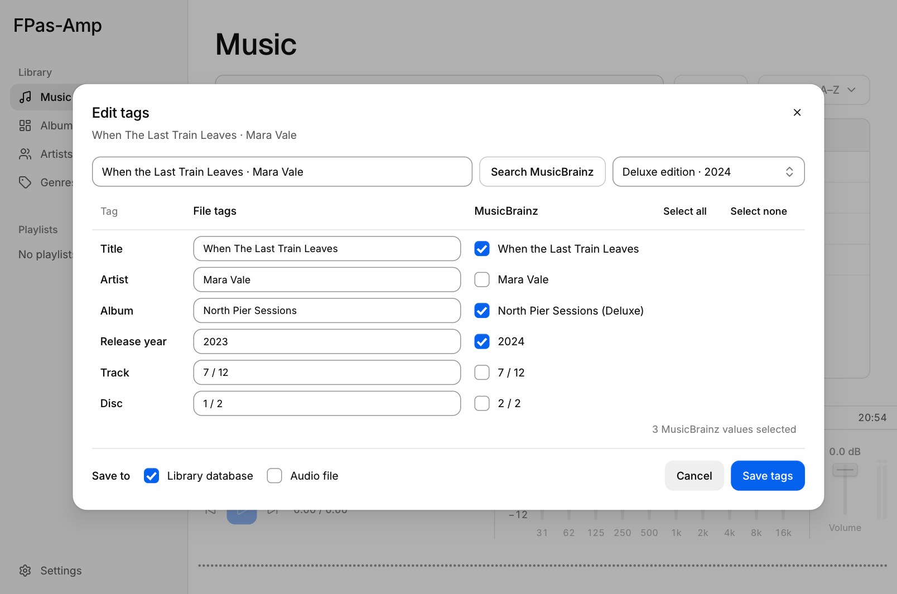
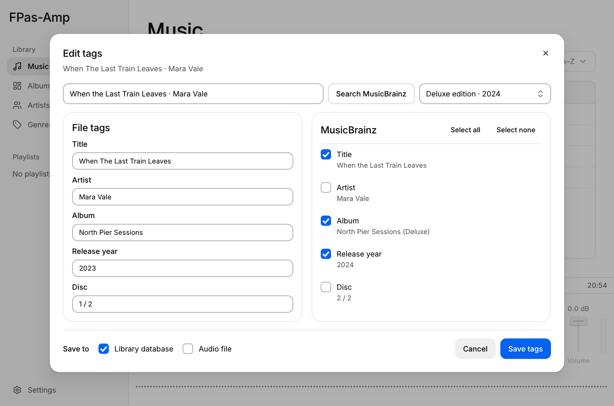
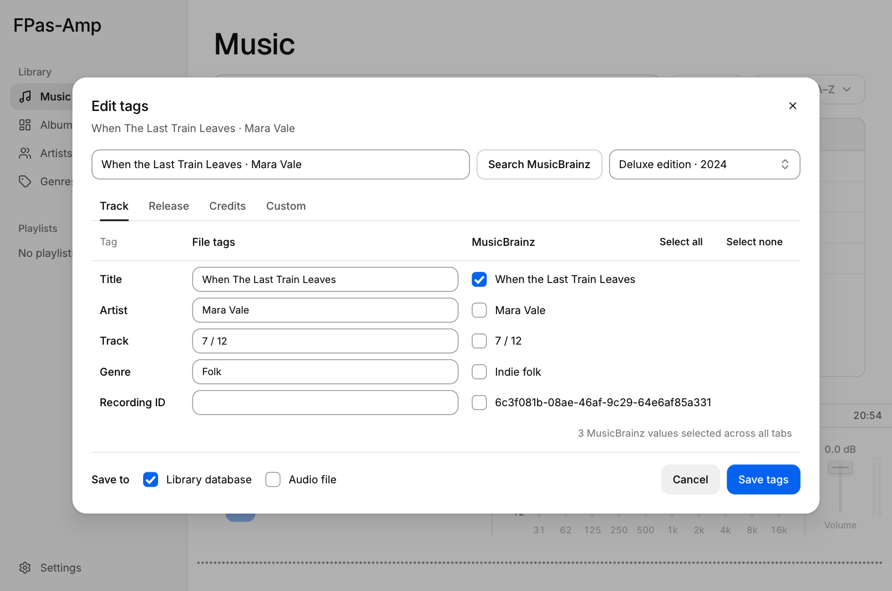
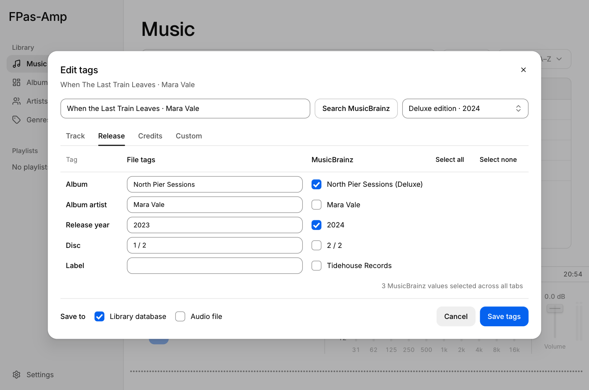
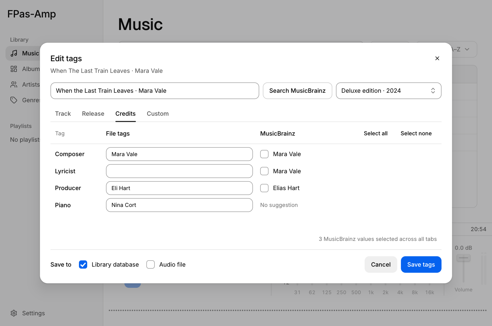
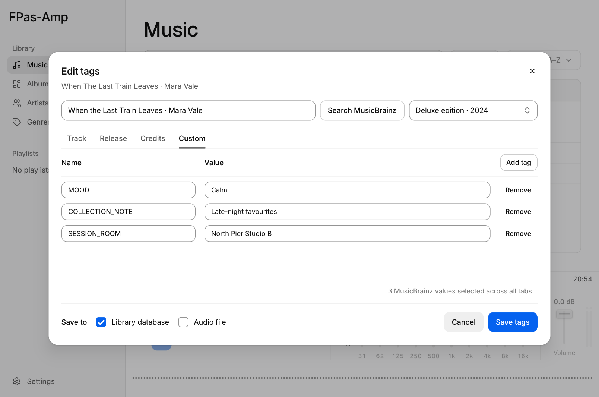
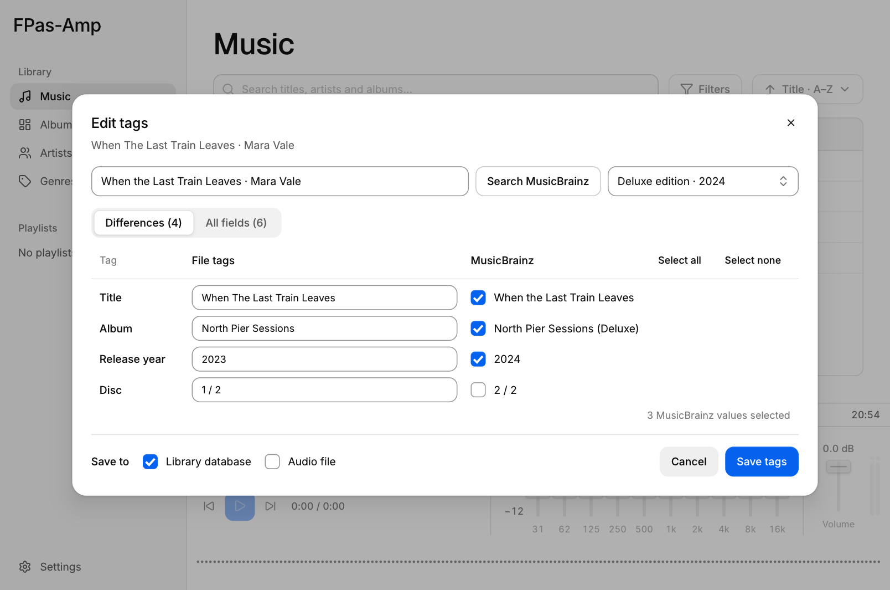
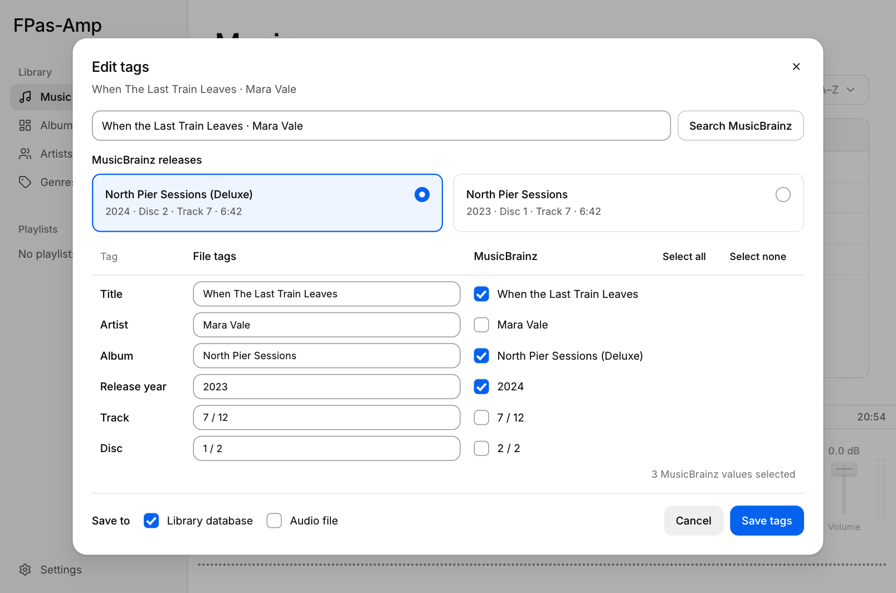

# Tag editor designs

**Edit tags** opens a separate dialog from the three-dot menu on a track row.
The left side starts with the file's tags as editable fields. On the right,
choose a MusicBrainz recording and release, then tick the proposed values to
use. **Select all** ticks every available proposal and **Select none** clears
the selection.

Checked MusicBrainz values take precedence when saving. Editing a field on the
left clears that field's checkbox and keeps the manual edit. With **Select
none**, the manual edits remain available. Track and disc positions should
support editing both the number and the total.

The designs show **Library database** selected and **Audio file** opt-in.
Either destination can be selected independently or together. **Save tags**
requires at least one destination. Database-only edits need to survive rescans.

The preview uses fictional track and release data and the current [FPas GUI
widget gallery](../../../../docs/ui/gui/README.md).

## A. Aligned rows

Each row has one tag label, an editable file value, and its MusicBrainz
counterpart. A release dropdown keeps the comparison compact.

## B. Two panels

Separate cards give the file form and the MusicBrainz checklist their own
headings. Each item names the tag, so the MusicBrainz list remains readable
independently.

## C. Tag groups

**Track**, **Release**, and **Credits** group the standard tags. The MusicBrainz
bulk controls apply across all three groups. **Custom** holds arbitrary tag
names and values.

### Track

Compare the title, credited artist, track number and total, genre, and
MusicBrainz recording ID.

### Release

Compare the album title, album artist, release year, disc position, and label.

### Credits

Edit contributor credits such as composer, lyricist, producer and performer.
An absent MusicBrainz value leaves the file field editable.

### Custom

Show the file's existing custom tags as editable name and value pairs.
**Add tag** opens a new row. **Remove** marks a tag for removal when saving.
Apply these manual changes to the same selected destinations. If the file
format cannot store an edited field, show the issue before saving and leave
the database destination available. Preserve custom tags the user leaves alone.

## D. Differences first

The default view shows fields that differ from the selected MusicBrainz release.
**All fields** gives access to the full editable list.

## E. Release cards

Radio cards expose the year, disc, track number and duration of each candidate
before values are selected below. This makes alternative editions easy to compare.

## Widget references

- [Dialog](../../../../docs/ui/gui/overlays/dialog.md), [text field](../../../../docs/ui/gui/inputs/text-field.md), [checkbox](../../../../docs/ui/gui/selection/checkbox.md)
- [Select](../../../../docs/ui/gui/inputs/select.md), [card](../../../../docs/ui/gui/feedback/card.md), [tabs](../../../../docs/ui/gui/navigation/tabs.md)
- [Segmented control](../../../../docs/ui/gui/actions/segmented-control.md), [radio cards](../../../../docs/ui/gui/selection/radio-cards.md)
