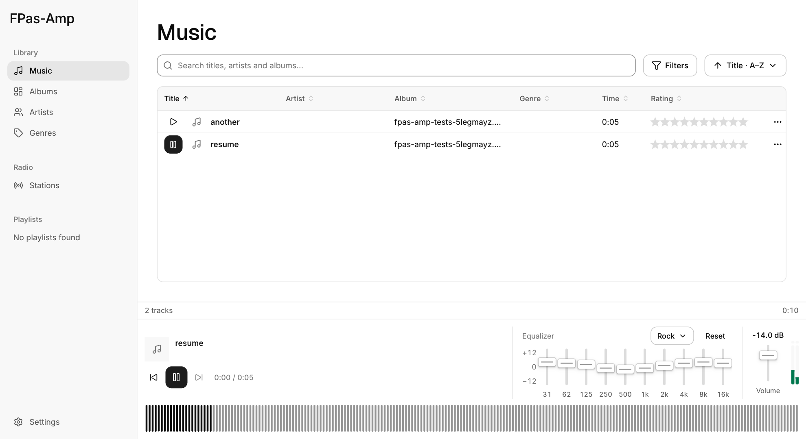

# Playback

The player sits at the bottom of the library, playlist and radio views.
It shows the selected title and artist, previous/play-pause/next, time,
equalizer, volume, stereo levels and a waveform for local tracks.

## Transport and queue

Click a row's Play button or double-click it to start playback. The visible
selection and sort order become the queue. The current track's button uses
the accent color and toggles play or pause. The next title starts when the
current one ends. Playback stops at the end of the queue. **Previous** restarts
the current track after three seconds of playback.

The player skips files whose indexed sources are all offline. Taking the
current source offline advances to the next available track when there is one.
Removing or resetting the last online source for the playing file stops it.
Pausing a scan keeps its indexed tracks available.

## Waveform and mixer

Click the waveform to seek. Drag to preview a position and release to seek
once. The accent color marks elapsed time. Waveform analysis starts in the
background when a track first plays. Seeking remains available while analysis
runs. The app caches the waveform for later plays and restarts.

The ten equalizer bands range from −12 to +12 dB. Choose **Rock**, **Pop**,
**Jazz**, **Classical**, **Bass Boost** or **Vocal** from the preset menu.
**None** and **Reset** return the bands to 0 dB. A curve that differs from
every preset shows as **Custom**. The volume fader ranges from −60 to 0 dB.
The stereo meters show the signal after equalization and volume. On a narrow
view, the strip keeps the transport and volume and hides the equalizer and meters.

## After a restart

Closing the window stops playback and saves the local selection, current track
and position. On restart, the app rebuilds the queue from the library and
restores that track paused. If it has disappeared, the app uses an available
replacement at the saved slot and starts it at zero when you press Play.
Volume and equalizer settings are restored. Radio playback starts on demand.
See [user files and recovery](user-files.md).
