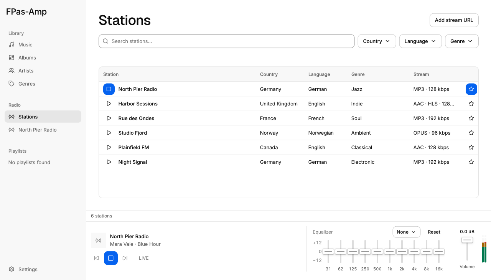
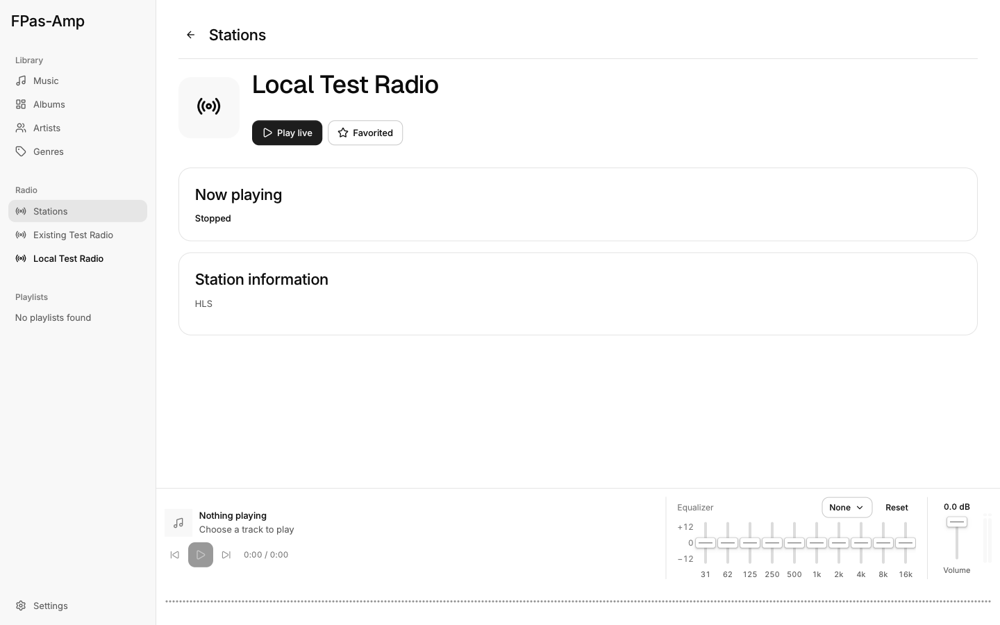

# Internet radio

> [!IMPORTANT]
> Radio playback requires **FFmpeg**. The app must be able to find
> `ffmpeg` on its `PATH`. Check with `ffmpeg -version`.

## Find a station

Open **Radio → Stations** to search the public Radio Browser directory by name
or filter by country, language and genre. The table shows up to 100 matching
stations and displays the codec, bitrate and HLS indicator when available.
Station search does not require an account. [Radio Browser API](https://docs.radio-browser.info/)

Click Play next to a station or double-click its row to listen. The player
shows **LIVE** when audio is flowing and displays the on-air title if the
stream supplies it. Radio uses the same equalizer, volume and stereo meters as
local music. Press **Stop** to close the stream and **Play** to reconnect.

## Save a favorite or add a stream

Click a star to save a station. Favorites appear below **Stations** in the
sidebar. Select one to see station information, the on-air title when
available and a website button if a website is listed.

**Add stream URL** saves an HTTP or HTTPS stream address under Radio. The
name is optional. With no name, the app uses the address's host name.
Radio supports direct audio streams and HLS URLs.

Favorites are stored locally and can be opened if the directory is unavailable.
Playing a favorite still requires access to its stream. If the connection
drops, press Play to reconnect. Local music playlists have their own
[sidebar section](browsing.md#playlists).
