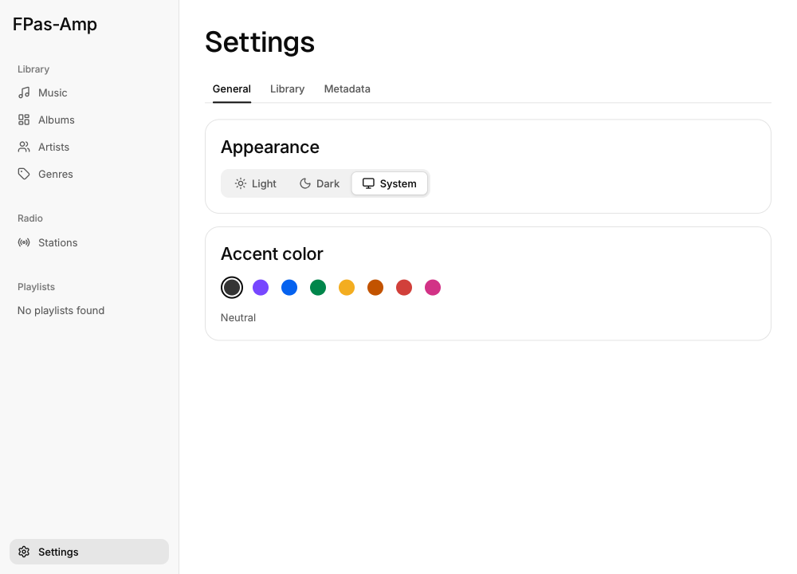
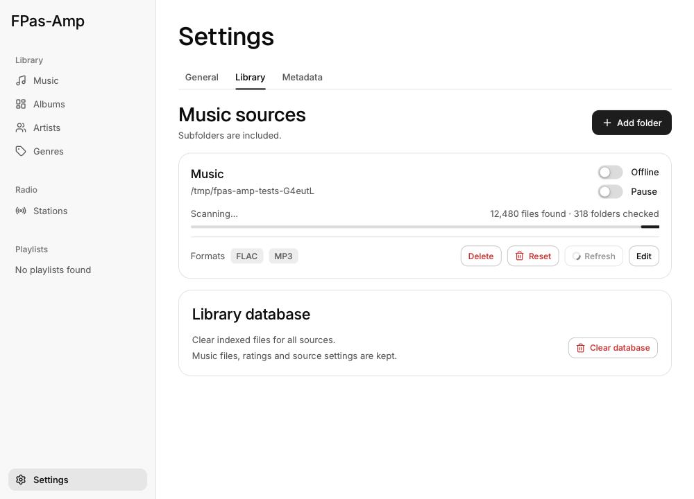
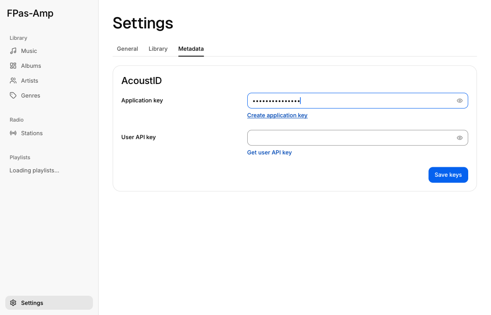

# Settings and music sources

Open **Settings** from the bottom of the sidebar. The tab you last used is
remembered independently of the page you were on when the app closed.

## General

Choose **Light**, **Dark** or **System**, then select an accent color.
**System** follows Windows app appearance changes while running and retains
the selected accent. On Linux with X11, it reads the dark `GTK_THEME` hint
when available and otherwise uses light.

## Library

Use **Add folder** to choose a music source. Subfolders are included.
Set the allowed formats separately for each source. New sources start with
FLAC, MP3 and M4A. Use **Save** to apply changes in the folder editor.

An online source is scanned in the background. The list shows the number of
files found and folders checked while the scan runs. Tag and audio property
reads continue separately. Previously indexed music is loaded from the database
when the app starts.

| Control | Effect |
| --- | --- |
| **Offline** | Stops accessing the source until it is online again. Cached entries stay indexed. |
| **Pause** | Stops scanning this source and keeps its indexed files available for playback. Turning Pause off checks for changes made while paused. |
| **Refresh** | Checks this source now. Available when the source is online, unpaused and idle. |
| **Edit** | Changes the source name or formats. |
| **Reset** | Removes this source's index associations and pauses it after confirmation. Shared entries stay indexed through their other sources. |
| **Delete** | Removes the source from settings and stops monitoring it after confirmation. |

**Clear database**, below the source list, clears the index for every source
and pauses the sources. Resetting, deleting or clearing affects the index and
settings. Music files and saved ratings are retained. See [user files
and recovery](user-files.md#library-databases).

## Metadata

The **AcoustID** card stores an optional **Application key** and **User API
key**. The application key enables **Scan AcoustID** in the tag editor.
The user key is retained for planned submission support. Both inputs are
masked. Use **Save keys** to write the values locally, or clear a field and
save to remove its key. [Dynamic playlist and identification plan](future/dynamic-playlist.md)

