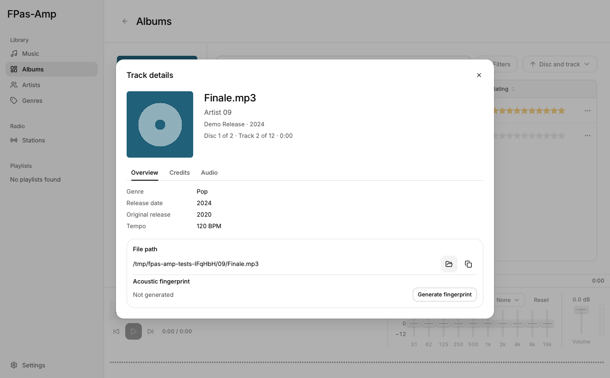
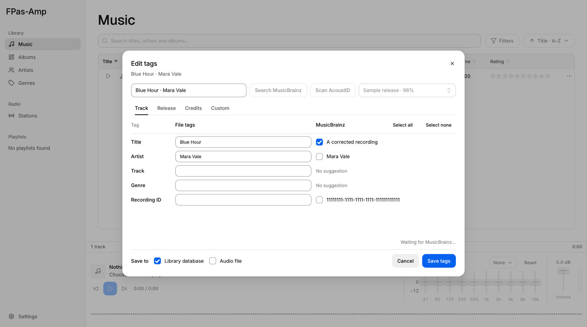
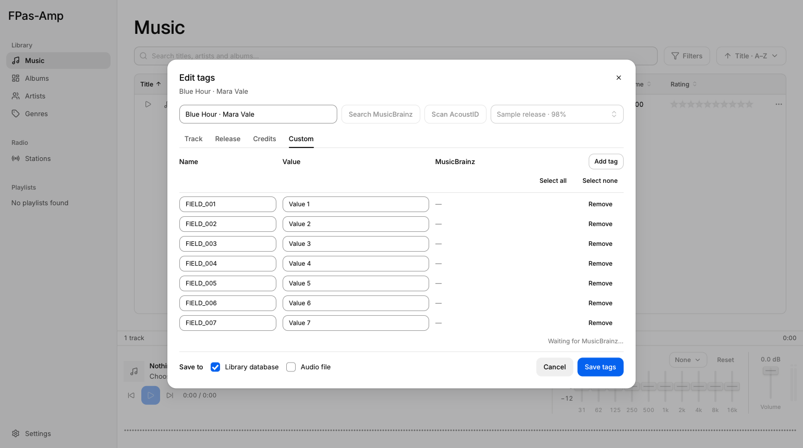

# Track details and tag editing

Open a track's three-dot menu to inspect its metadata or edit it.

## Track details

- **Overview** shows the release date, original release, genre and tempo when
  available. The header shows the artwork, title, artist, album, year, disc
  and track numbers, and duration.
- **Credits** shows performers, composers and the record label.
- **Audio** shows technical properties such as codec, bitrate, sample rate,
  bit depth and channels.

Every tab has buttons to open the containing folder and copy the full file
path. Use **Generate fingerprint** to calculate a Chromaprint fingerprint
locally, or copy the full fingerprint once it is available. Playback also
starts the calculation for the selected track. Results are cached in
`library.db`. Generating a fingerprint leaves the audio file unchanged.

## Edit tags

Choose **Edit tags** to compare editable local values with MusicBrainz
suggestions. **Track**, **Release**, **Credits** and **Custom** group the
fields. Search MusicBrainz, then choose a recording and release. Use
**Scan AcoustID** to look for a match by fingerprint instead of typing a
search. It uses the application key from [Settings → Metadata](settings.md#metadata).

Check each suggestion you want, or use **Select all** and **Select none**.
Typing in a local field clears the selected suggestion for that field.
Recording suggestions stay available if the release lookup fails. The editor
shows the wait time and disables provider controls during requests and cooldowns.

The **Custom** tab accepts additional name and value pairs and includes
MusicBrainz proposals such as barcodes and release IDs. Only the list scrolls.
The tabs, headers and save controls stay in place. Multiline text has its own
editor. Binary ID3 data stays intact when you edit other fields.

Choose where **Save tags** writes the result. **Library database** saves a
local override that survives a rescan. Check **Audio file** to write the tags
to the file. You can choose either destination or both.
See the [tag editing reference](desktop.md#editing-track-tags) for provider
pacing and recovery behavior.
