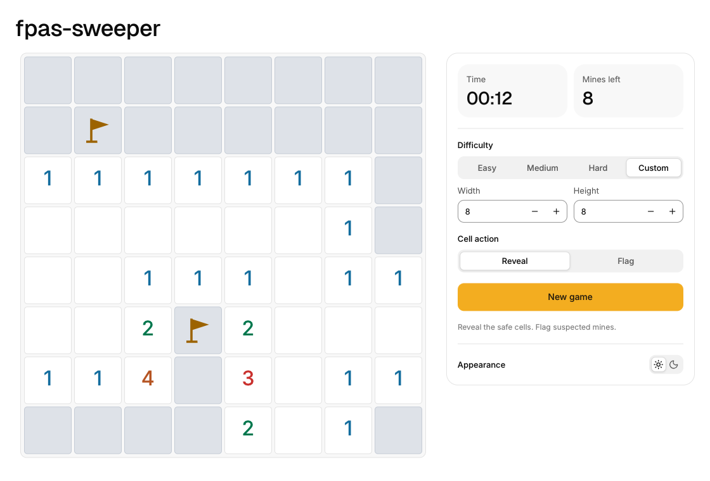

# fpas-sweeper

A Minesweeper-style desktop game written in Functional Pascal with the native CUI
GUI. Play Easy, Medium or Hard, or choose **Custom** to set the board width and
height independently. Switch between Light and Dark during a round.



## Build and run

Set up the [local FPAS SDK](../../docs/build/development.md#build-an-fpas-application)
and the [native CUI build tools](../../docs/ui/gui/native-build.md#prerequisites).
Run from this directory.

```sh
dotnet build fpas-sweeper.slnx
dotnet run --project src/FpasSweeper/FpasSweeper.fpasproj --no-build
```

Select a difficulty and press **New game**. Click a tile in **Reveal** mode to
open it or in **Flag** mode to mark it. With the board focused, use the arrow
keys to move, Enter or Space to use the selected action, and F to toggle a flag
directly. Open every safe tile to win.

See the [app documentation](doc/README.md) for rules and source layout, and the
[test guide](tests/README.md) to run the game tests.
