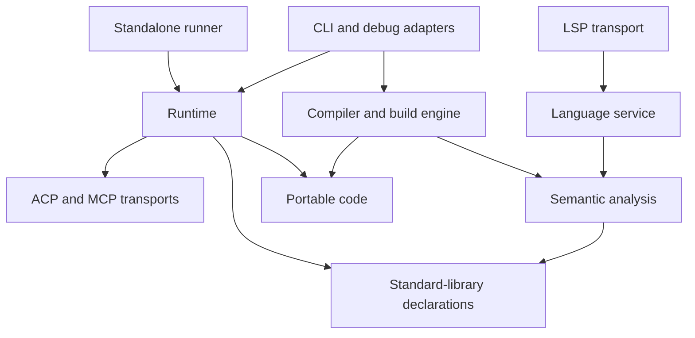

# Rust architecture

The workspace separates the language model and compilation from execution.
Compiler and editor analysis use shared declarations and portable code metadata;
runtime values, memory ownership, and VM execution belong to one crate.



The diagram shows the main dependency boundaries, not every workspace dependency.
Parsing, diagnostics, numeric rules, project loading, and binary codecs retain
their focused crates. Cargo manages common dependency versions, the lockfile,
lint policy, and build profiles at the workspace root.

## Application entry points

Three independent Cargo packages supply the installed executables:

- [`fpas-cli`](../crates/fpas-cli/) builds `fpas`: project commands, compilation,
  execution, and debug adapters. It does not depend on `fpas-lsp`.
- [`fpas-lsp`](../crates/fpas-lsp/) builds the stdio language server on top of
  `fpas-language-service`. It needs neither the compiler backend nor the runtime.
- [`fpas-runner`](../crates/fpas-runner/) builds the runtime entry point for
  bundled programs. Its production dependencies are the bundle codec,
  diagnostics, and runtime; it has no compiler or editor dependency.

The VS Code extension resolves `fpas` once and queries `fpas env --json` for
the adjacent `languageServer` executable and `standardLibrary` directory. It
starts that server directly and passes the library through LSP initialization.
Other editors can start `fpas-lsp` directly with the same initialization option.

`cargo build --workspace` builds all three programs. Distribution scripts ship
them together with `lib/`. `fpas build --executable` finds the adjacent runner
and appends the verified program image; generated applications need no compiler
or source library installation. For targeted CLI tests that create native
executables, build `fpas-runner` first with `cargo build -p fpas-runner`.

## Portable contracts

[`fpas-code`](../crates/fpas-code/) owns packed instructions, decoded operations,
intrinsic identifiers, function and type metadata, source/debug metadata, and
executable validation. Its types contain no interpreter values or host handles.
The compiler, linker, persistent program format, and runtime use these same Rust
types directly.

An `Executable` is an untrusted candidate. Verification checks its invariants and
returns an immutable `VerifiedExecutable`, including decoded instructions and
canonical function names. Execution receives this verified form.

Each independently verified or cloned image has an opaque identity. Sharing an
`Arc<VerifiedExecutable>` preserves that identity. `FunctionTarget` binds a valid
function index and its canonical name to the exact image; structural equality
between images does not authorize a function value to execute in another image.
See [runtime ownership](pascal/program-structure/runtime-ownership.md).

[`fpas-builtins`](../crates/fpas-builtins/) owns standard-unit and symbol names,
native record/error declarations, console discriminant order, and aggregate
names retained for native construction. Semantic registration and native value
construction use one catalog. The catalog depends on the ACP model for its
generated declarations, without loading connection drivers or the interpreter.

## Compilation and editor analysis

The parser produces syntax and diagnostics. Semantic analysis resolves names and
types; the compiler lowers checked programs through typed IR to register code.
The unit, linker, program, and build crates own their artifact and project
responsibilities. Their production dependencies do not include the runtime.

The language service exposes editor operations through document snapshots and
project analysis. The LSP crate handles protocol transport. Analysis shares the
compiler's language rules and the portable declaration/model layers; terminal
backends, native operation implementations, and VM memory management are not
part of its dependency graph.

## Execution and host operations

[`fpas-runtime`](../crates/fpas-runtime/) contains:

- `value`: runtime values, shared aggregates, mutable cells, ownership domains,
  tracing, and collection.
- `execution`: register execution, frames, callbacks, tasks, debugger state, and
  the adapters between FPAS operations and host services.
- `stdlib`: native operations, console backends, and native value builders.
- `profile`: process-wide execution counters.

These modules share a crate so frequently used value operations remain close to
instruction execution. Runtime reexports `fpas-code` for execution clients; this
does not create a second code representation.

Runtime admission derives aggregate layouts and cached `SharedStr` constants
from verified metadata. This preparation belongs to runtime layouts, not to the
portable executable. Worker layouts share the constant table. The interpreter
loads prepared strings without reconstructing them for each constant load.

ACP model, codec, and connection crates retain their protocol boundaries. MCP
serving remains in `fpas-mcp`. Runtime adapters convert between protocol data and
FPAS values and apply the executing program's ownership and lifetime rules.
Ordinary instruction execution does not go through a host-service interface.

## Tests and dependency checks

Runtime unit tests use the ordinary library target. Compiler-produced fixtures
and execution share `fpas-code` types.

`cargo test --workspace` covers compiler, runtime, artifact, debugger, and CLI
integration. Runtime integration tests include process-isolated
[memory tests](../crates/fpas-runtime/tests/gc_memory/README.md), process-terminal
tests, and server lifecycle tests. The FPAS suite exercises the language and
standard library through unchanged source programs.

Inspect production dependencies with:

```sh
cargo tree -p fpas-compiler -e normal
cargo tree -p fpas-lsp -e normal
cargo tree -p fpas-runner -e normal
```

The compiler and LSP graphs should not include `fpas-runtime`, `fpas-acp`,
`fpas-acp-codec`, or `fpas-mcp`. Compiler/editor code may depend on `fpas-acp-model`
for declarations.
The runner graph must not include the compiler, build engine, or language service.
Dependency-boundary tests enforce the three executable packages' separation.
Use normal dependencies for this check: runtime's development dependency on the
compiler supplies execution fixtures and is intentionally outside that graph.

The boundary design follows the separation of language data, analysis, and outer
adapters described in [rust-analyzer's architecture](https://rust-analyzer.github.io/book/contributing/architecture.html).
Workspace configuration follows the [Cargo workspace model](https://doc.rust-lang.org/cargo/reference/workspaces.html).
