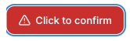

# Confirm button

Ask for a second activation before carrying out a destructive action. Available in **GUI and TUI**.



## Example

```pascal
unit Docs.Ui.Actions.ConfirmButton;

uses Fpas.Ui.Elements as E, Fpas.Ui.Widgets.Actions.ConfirmButtons as C;

// Builds the example view.
// ## Returns
// The widget with its message type.
public function View(): E.Element<string>;
begin
  return C.ConfirmButton<string>('delete', 'Delete project', 'delete',
    new C.Options(ConfirmLabel := 'Confirm deletion'));
end function;

end unit;
```

## Options and defaults

| Option | Default or requirement |
| --- | --- |
| `ConfirmLabel` | Click to confirm |
| `TimeoutMilliseconds` | 3000 |
| `Variant / ControlSize / Enabled` | Secondary / Medium / true |

## Interaction

The first click, Enter or Space arms the button. The second activation
within the time limit sends its message once. Escape, clicking outside or
letting the limit expire disarms it. TUI shows the remaining seconds in
cells.

## See also

- [Widget API and types](../../../src/Fpas.Ui/Widgets/Actions/ConfirmButtons.fpas)
- [Gallery example](../../../examples/ui/gui/gallery/Pages/Actions/Widgets/ConfirmButton.fpas)
- [Actions](README.md)
