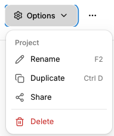

# Dropdown menu

Open a list of commands from a labeled or icon-only trigger. Available in **GUI and TUI**.



## Example

```pascal
unit Docs.Ui.Actions.DropdownMenu;

uses Fpas.Ui.Elements as E, Fpas.Ui.Widgets.Overlays.Menus as M;

// Builds the example view.
// ## Returns
// The widget with its message type.
public function View(): E.Element<string>;
begin
  return M.Menu<string>('options', 'Options', [
    M.Entry<string>.Label('Project'),
    M.Entry<string>.Action(new M.Item<string>('rename', 'Rename', 'rename')),
    M.Entry<string>.Separator,
    M.Entry<string>.Action(new M.Item<string>('delete', 'Delete', 'delete', Danger := true))
  ]);
end function;

end unit;
```

## Options and defaults

| Option | Default or requirement |
| --- | --- |
| `Variant` | Default resolves to secondary for a labeled trigger and ghost for an icon-only trigger |
| `IconOnly / Enabled` | false / true |
| `Position` | BottomStart |
| `Width` | 0 uses content sizing with a 180-point minimum in GUI |

## Interaction

Click, Enter or Down opens the menu. Up and Down move through enabled commands.
Enter chooses and Escape closes. Command keys stay stable when captions change.
Section labels and separators have no action. Shortcut text displays a hint.

## See also

- [Widget API and types](../../../src/Fpas.Ui/Widgets/Overlays/Menus.fpas)
- [Gallery example](../../../examples/ui/gui/gallery/Pages/Buttons/Widgets/DropdownMenu.fpas)
- [Actions](README.md)
