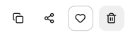

# Icon button

Use a glyph for a compact, familiar action. Give it a tooltip that names the action. Available in **GUI and TUI**.



## Example

```pascal
unit Docs.Ui.Actions.IconButton;

uses Fpas.Ui.Elements as E, Fpas.Ui.Widgets.Actions.IconButtons as B,
  System as Sys;

// Builds the example view.
// ## Returns
// The widget with its message type.
public function View(): E.Element<string>;
begin
  return B.IconButton<string>('share', Sys.Char.ConvertFromUtf32($E156),
    'Share', 'share', new B.Options(TerminalGlyph := '↗'));
end function;

end unit;
```

## Options and defaults

| Option | Default or requirement |
| --- | --- |
| `Variant / ControlSize` | Ghost / Medium |
| `Enabled / Loading / Selected` | true / false / false |
| `TerminalGlyph / Shortcut` | Both empty |

## Interaction

Tab focuses the button. Click, Enter or Space sends its message. Busy
buttons keep focus and suppress activation. The GUI uses the CUI icon font.
TUI uses the terminal glyph or the tooltip text. Shortcut displays a hint.

## See also

- [Widget API and types](../../../src/Fpas.Ui/Widgets/Actions/IconButtons.fpas)
- [Gallery example](../../../examples/ui/gui/gallery/Pages/Buttons/View.fpas)
- [Actions](README.md)
