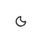

# Theme toggle

Switch between two concrete appearances with a single button. Available in **GUI and TUI**.



## Example

```pascal
unit Docs.Ui.Actions.ThemeToggle;

uses Fpas.Ui.Elements as E, Fpas.Ui.Widgets.Theming.ThemeToggles as T,
  Fpas.Ui.Widgets.Theming.Themes as Themes;

// Builds the example view.
// ## Parameters
// - `Mode`: Current application value.
// ## Returns
// The widget with its message type.
public function View(Mode: Themes.Mode): E.Element<Themes.Mode>;
begin
  return T.ThemeToggle<Themes.Mode>('appearance', Mode,
    function(Choice: Themes.Mode): Themes.Mode => Choice);
end function;

end unit;
```

## Options and defaults

| Option | Default or requirement |
| --- | --- |
| `Enabled` | true |
| `Appearance` | Light or Dark from the model |

## Interaction

Click, Enter or Space proposes the opposite appearance. Pass the concrete
value the user currently sees and apply the new palette through ThemeFor.
GUI shows a sun or moon icon and TUI gives the target appearance a readable
caption.

## See also

- [Widget API and types](../../../src/Fpas.Ui/Widgets/Theming/ThemeToggles.fpas)
- [Gallery example](../../../examples/ui/gui/gallery/Pages/Actions/Widgets/ThemeSwitcher.fpas)
- [Actions](README.md)
