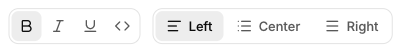

# Toggle group

Group independent flags such as text formatting or exclusive choices such as alignment. Available in **GUI**.



## Example

```pascal
unit Docs.Ui.Actions.ToggleGroup;

uses Fpas.Ui.Elements as E, Fpas.Ui.Widgets.Actions.ToggleGroups as T;

// Builds the example view.
// ## Parameters
// - `Selected`: Current application value.
// ## Returns
// The widget with its message type.
public function View(Selected: array of bool): E.Element<array of bool>;
begin
  return T.ToggleGroup<array of bool>('format', [new T.Item('Bold'), new T.Item('Italic')],
    Selected, function(Flags: array of bool): array of bool => Flags);
end function;

end unit;
```

## Options and defaults

| Option | Default or requirement |
| --- | --- |
| `Exclusive / IconOnly` | false / false |
| `ControlSize / Enabled` | Medium / true |
| `Items` | 1 to 32 positional items |

## Interaction

Pass one selected flag per item. Exclusive mode requires exactly one
selected item. Tab visits enabled items and the arrow keys move focus
horizontally. Click, Enter or Space proposes a fresh array of flags. Keep
the array in the model after accepting a proposal.

## See also

- [Widget API and types](../../../src/Fpas.Ui/Widgets/Actions/ToggleGroups.fpas)
- [Gallery example](../../../examples/ui/gui/gallery/Pages/Actions/Widgets/ToggleGroup.fpas)
- [Actions](README.md)
