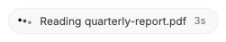

# Agent status

The gallery shows a file-read status pill while a reply is in progress.
Available in **GUI**.



## Example

```pascal
unit Docs.Ui.Ai.AgentStatus;

uses Fpas.Ui.Elements as E, Fpas.Ui.Widgets.Ai.AgentStatuses as W, Fpas.Ui.Widgets.Feedback.TaskStates as T;

// Displays the current running action.
// ## Parameters
// - `Label`: Current activity caption.
// - `Seconds`: Elapsed seconds.
// ## Returns
// The native status pill.
public function View(Label: string; Seconds: float): E.Element<string>;
begin
  return W.AgentStatus<string>('active-task', Label,
    new W.Options(Status := T.Status.Running, Seconds := Seconds));
end function;

end unit;
```

## Options and defaults

| Option | Default or requirement |
| --- | --- |
| `Status / Seconds / Icon` | Pending / 0 / empty. An explicit glyph overrides the native status icon. |

## Interaction

Pass a new caption, state and time as the active task changes. The pill
is passive.

## See also

- [Widget API and types](../../../src/Fpas.Ui/Widgets/Ai/AgentStatuses.fpas)
- [Gallery example](../../../examples/ui/gui/gallery/Pages/Ai/View.fpas)
- [Agent plan](agent-plan.md)
- [AI](README.md)
