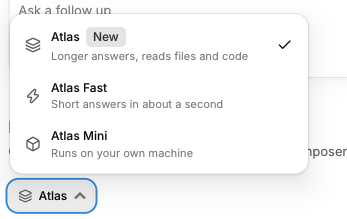

# Model picker

The gallery shows the model menu in its composer and a separate
standalone picker.
Available in **GUI**.


## Example

```pascal
unit Docs.Ui.Ai.ModelPicker;

uses Fpas.Ui.Elements as E, Fpas.Ui.Widgets.Ai.ModelPickers as W;

// Shows the active model and available choices.
// ## Parameters
// - `Models`: Available models in display order.
// - `Current`: Selected zero-based index.
// ## Returns
// The picker with proposed model indices.
public function View(Models: array of W.Item; Current: int): E.Element<int>;
begin
  return W.ModelPicker<int>('model', Models, Current, function(Index: int): int => Index);
end function;

end unit;
```

## Options and defaults

| Option | Default or requirement |
| --- | --- |
| `Item.Name / Detail / Badge / Icon` | Supply the name. Detail, Badge and Icon default to empty. |
| `Ghost / Placement / Enabled` | false / TopStart / true. Ghost uses the quiet trigger. |

## Interaction

Open the menu and choose a model. Persist the proposed index and use
that selection when sending a request. To embed the same menu in a
composer, set its Models and Selected fields.



## See also

- [Widget API and types](../../../src/Fpas.Ui/Widgets/Ai/ModelPickers.fpas)
- [Gallery example](../../../examples/ui/gui/gallery/Pages/Ai/View.fpas)
- [Composer](../voice/composer.md)
- [AI](README.md)
