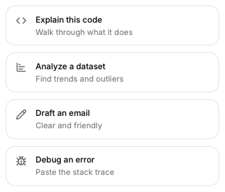

# Prompt suggestions

The gallery has four suggestions beside its conversation. Choosing one
adds its title to the draft.
Available in **GUI**.



## Example

```pascal
unit Docs.Ui.Ai.PromptSuggestions;

uses Fpas.Ui.Elements as E, Fpas.Ui.Widgets.Ai.PromptSuggestions as W;

// Offers example starting prompts.
// ## Parameters
// - `Items`: Suggestion cards in display order.
// ## Returns
// The cards with the chosen index as an application message.
public function View(Items: array of W.Item): E.Element<int>;
begin
  return W.PromptSuggestions<int>('prompts', Items, function(Index: int): int => Index,
    new W.Options(Columns := 1));
end function;

end unit;
```

## Options and defaults

| Option | Default or requirement |
| --- | --- |
| `Item.Title / Detail / Icon` | Supply a title. Detail and Icon default to empty. |
| `Columns / Enabled` | 0 / true. Zero uses the native column count. |

## Interaction

Look up the selected index and apply its text to the draft. Sending
a request is a separate application action.

## See also

- [Widget API and types](../../../src/Fpas.Ui/Widgets/Ai/PromptSuggestions.fpas)
- [Gallery example](../../../examples/ui/gui/gallery/Pages/Ai/View.fpas)
- [Composer](../voice/composer.md)
- [AI](README.md)
