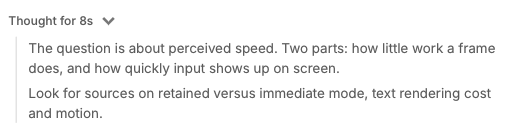

# Reasoning panel

The gallery shows an expandable reasoning panel and changes its heading
while a reply is in progress.
Available in **GUI**.



## Example

```pascal
unit Docs.Ui.Ai.Reasoning;

uses Fpas.Ui.Elements as E, Fpas.Ui.Widgets.Ai.Reasonings as W;

// Shows the current reasoning summary.
// ## Parameters
// - `Summary`: Application-supplied summary.
// - `Thinking`: Whether generation is running.
// - `Seconds`: Elapsed seconds.
// ## Returns
// The native disclosure panel.
public function View(Summary: string; Thinking: bool; Seconds: float): E.Element<string>;
begin
  return W.Reasoning<string>('reasoning', [E.Text<string>(Summary)],
    new W.Options(Thinking := Thinking, Seconds := Seconds));
end function;

end unit;
```

## Options and defaults

| Option | Default or requirement |
| --- | --- |
| `Children` | Supply the view elements to draw inside the panel. |
| `Thinking / Seconds` | false / 0. Thinking opens the panel and shows the running state. |
| `Title / Enabled` | Empty / true. Title overrides the native heading. |

## Interaction

Click the heading to toggle the disclosure. Keep the summary and elapsed
time in the application model. CUI retains the open state for the mounted
panel.

Declare dialogs, sheets, command palettes and file pickers outside the reasoning
body. Validation rejects these modal declarations inside the body even when
they are closed, because CUI owns its disclosure state.

## See also

- [Widget API and types](../../../src/Fpas.Ui/Widgets/Ai/Reasonings.fpas)
- [Gallery example](../../../examples/ui/gui/gallery/Pages/Ai/View.fpas)
- [AI](README.md)
