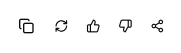

# Response actions

The gallery places the response toolbar beside its context meter.
Available in **GUI**.



## Example

```pascal
unit Docs.Ui.Ai.ResponseActions;

uses Fpas.Ui.Elements as E, Fpas.Ui.Widgets.Ai.ResponseActions as W;

// Adds actions to an answer.
// ## Parameters
// - `Answer`: Text CUI copies when Copy is used.
// - `Vote`: Current vote, from minus one through one.
// ## Returns
// The toolbar with response action messages.
public function View(Answer: string; Vote: int): E.Element<W.Event>;
begin
  return W.ResponseActions<W.Event>('response-actions', Vote,
    function(Change: W.Event): W.Event => Change, new W.Options(CopyText := Answer));
end function;

end unit;
```

## Options and defaults

| Option | Default or requirement |
| --- | --- |
| `Vote / CopyText` | Vote uses minus one for down, zero for neutral and one for up. Null Vote leaves voting momentary, with no selected state. Null CopyText hides Copy. |
| `HideRegenerate / HideShare / Enabled` | false / false / true. |

## Interaction

CUI copies the supplied text and reports Copy. Persist vote proposals
and handle regeneration or sharing in the application.

## See also

- [Widget API and types](../../../src/Fpas.Ui/Widgets/Ai/ResponseActions.fpas)
- [Gallery example](../../../examples/ui/gui/gallery/Pages/Ai/View.fpas)
- [AI](README.md)
