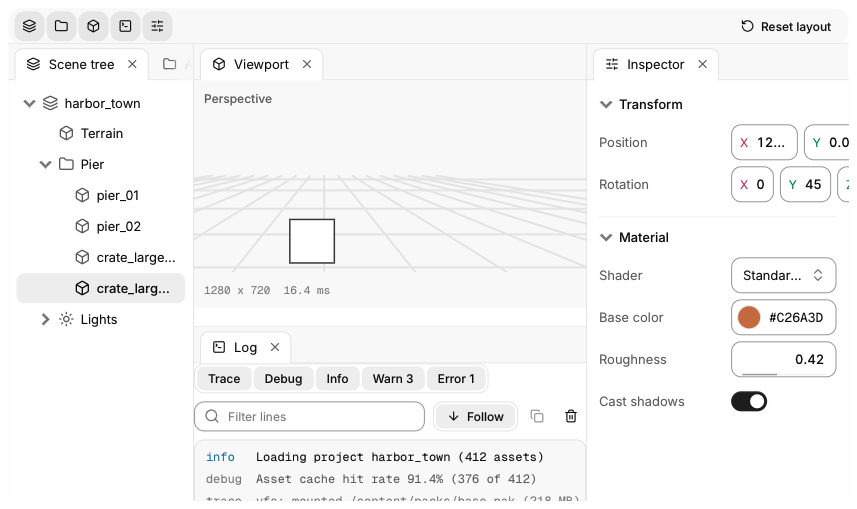

# Docking workspace

App chrome docks Scene tree and Assets together, with separate Viewport,
Log and Inspector panes.
Available in **GUI**.



## Example

```pascal
unit Docs.Ui.AppChrome.Dockspace;

uses Fpas.Ui.Elements as E, Fpas.Ui.Layout as L, Fpas.Ui.Widgets.Desktop.Dockspaces as W;

// Creates an editor with two dockable panels.
// ## Parameters
// - `SavedLayout`: Most recent native layout accepted by the model.
// ## Returns
// The workspace with serialized layout changes as messages.
public function View(SavedLayout: string): E.Element<string>;
begin
  const Initial: string := 'dock1 h0.28([*files],[*editor])';
  const Layout: string := if SavedLayout = '' then Initial else SavedLayout end if;
  return W.Dockspace<string>('editor-workspace', [
    new W.Panel<string>('files', 'Files', E.Text<string>('README.md')),
    new W.Panel<string>('editor', 'Editor', E.Text<string>('Document'))
  ], new W.Options(
    Height := L.Extent.Fixed(L.Measure.Logical(300)),
    InitialLayout := Layout,
    KnownLayout := SavedLayout
  ), function(Value: string): string => Value);
end function;

end unit;
```

## Options and defaults

| Option | Default or requirement |
| --- | --- |
| `Panels` | Include open, closed and inactive panels. Keys are stable and at most 63 UTF-8 bytes. |
| `Width / Height / MinimumWidth / MinimumHeight` | Fill / Fill / 0 / 0. Zero uses the native minimum. |
| `InitialLayout / Load / KnownLayout` | Empty / null / empty. Use Load with a new revision for each explicit restore. |
| `Shortcuts` | false. Enable window-wide shortcuts for the active group of tabs. |

## Interaction

Drag a tab to dock it or a divider to resize its pane. A panel with an
`OnOpenChanged` callback can propose a close. Accept it by updating
`Panel.Open`. Save layout proposals from `OnLayoutChanged` and pass the most
recent accepted value as `KnownLayout` to avoid repeat notifications.

## See also

- [Widget API and types](../../../src/Fpas.Ui/Widgets/Desktop/Dockspaces.fpas)
- [Gallery example](../../../examples/ui/gui/gallery/Pages/Desktop/Workspace.fpas)
- [Split view](split-view.md)
- [Chapter index](README.md)
