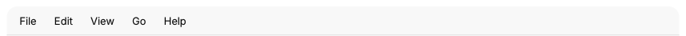
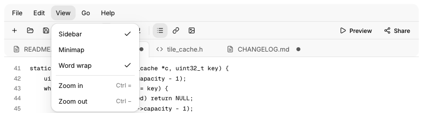

# Menu bar

App chrome places File, Edit, View, Go and Help above an editor.
Available in **GUI**.



## Example

```pascal
unit Docs.Ui.AppChrome.MenuBar;

uses
  Fpas.Ui.Elements as E, Fpas.Ui.Widgets.Desktop.MenuBars as W,
  Fpas.Ui.Widgets.Overlays.Menus as M;

// Shows a File menu and its commands.
// ## Returns
// A menu bar that sends the chosen command.
public function View(): E.Element<string>;
begin
  return W.MenuBar<string>('editor-menus', [
    new W.Menu<string>('file', 'File', [
      M.Entry<string>.Action(new M.Item<string>('open', 'Open…', 'open', Shortcut := 'Ctrl O')),
      M.Entry<string>.Separator,
      M.Entry<string>.Action(new M.Item<string>('save', 'Save', 'save', Shortcut := 'Ctrl S'))
    ])
  ]);
end function;

end unit;
```

## Options and defaults

| Option | Default or requirement |
| --- | --- |
| `Menu.Key / Label / Entries` | A stable key, a visible title and the rows in its popup. |
| `Menu.Mnemonic / Width / Enabled` | Empty / 0 / true. Empty uses the title's first mnemonic. A width of 0 uses native sizing. |
| `HideBorder` | false. Set true to omit the bottom hairline. |

## Interaction

Click a title or use its Alt mnemonic. F10 enters menu navigation. Use
arrows to move and Enter to activate a command. Set check marks from the
model. The command's `Shortcut` string displays a hint.



## See also

- [Widget API and types](../../../src/Fpas.Ui/Widgets/Desktop/MenuBars.fpas)
- [Gallery example](../../../examples/ui/gui/gallery/Pages/Desktop/Editor.fpas)
- [Command menu](../actions/dropdown-menu.md)
- [Chapter index](README.md)
