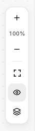

# Canvas controls

Use canvas controls to place a zoom rail over a canvas. The gallery adds
Grid and Layers toggles.
Available in **GUI**.



## Example

```pascal
unit Docs.Ui.CanvasAndBars.CanvasControls;

uses Fpas.Ui.Elements as E, Fpas.Ui.Widgets.Canvas.CanvasControls as W, Fpas.Ui.Widgets.Editors.NodeEditors as N;

// Adds zoom and fit controls to a canvas child.
// ## Parameters
// - `Child`: Canvas under the rail.
// - `Viewport`: Current pan and zoom.
// - `Toggles`: Glyphs, labels and states for additional toggles.
// ## Returns
// The canvas with viewport and toggle proposals.
public function View(Child: E.Element<W.Event>; Viewport: N.View; Toggles: array of W.Toggle): E.Element<W.Event>;
begin
  return W.CanvasControls<W.Event>('zoom-rail', Viewport, Toggles,
    function(Change: W.Event): W.Event => Change, Child);
end function;

end unit;
```

## Options and defaults

| Option | Default or requirement |
| --- | --- |
| `Content / Steps` | null / empty. Pass bounds to let CUI compute fit. Steps can supply ascending zoom presets. |
| `HideFit / StartSide / Enabled` | false / false / true. StartSide places the rail at the logical start edge. |

## Interaction

Plus and minus use zoom presets. Click the percentage to reset the zoom.
Store the proposed viewport and toggle states. When Fit is requested
without bounds, compute the viewport in the application.

## See also

- [Widget API and types](../../../src/Fpas.Ui/Widgets/Canvas/CanvasControls.fpas)
- [Gallery example](../../../examples/ui/gui/gallery/Pages/Canvas/View.fpas)
- [Node editor](node-editor.md)
- [Canvas and bars](README.md)
