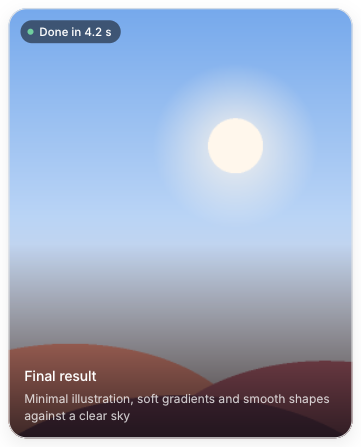

# Result card

Use a result card for a visual output. The gallery presents an image
with a caption and elapsed-time badge.
Available in **GUI**.



## Example

```pascal
unit Docs.Ui.CanvasAndBars.ResultCard;

uses Fpas.Ui.Elements as E, Fpas.Ui.Widgets.Canvas.ResultCards as W, Fpas.Ui.Widgets.Media.MediaImages as M;

// Shows the output image and offers a preview.
// ## Parameters
// - `Picture`: A file or an immutable RGBA picture.
// ## Returns
// The card with a message to open the preview.
public function View(Picture: M.Source): E.Element<string>;
begin
  return W.ResultCard<string>('result', Picture, 'Final result', 'show-preview',
    new W.Options(Caption := 'Generated illustration', Badge := 'Done'));
end function;

end unit;
```

## Options and defaults

| Option | Default or requirement |
| --- | --- |
| `Caption / Badge / BadgeTone` | null / null / Neutral. Neutral uses the native status tone. |
| `Width / Aspect / Enabled` | Fill / 0 / true. Aspect is height divided by width. Zero uses native sizing. |

## Interaction

Handle the supplied message when the card is activated. Place any
export tools alongside the card, as the gallery does with a floating
toolbar.

## See also

- [Widget API and types](../../../src/Fpas.Ui/Widgets/Canvas/ResultCards.fpas)
- [Gallery example](../../../examples/ui/gui/gallery/Pages/Canvas/View.fpas)
- [Toolbar](toolbar.md)
- [Canvas and bars](README.md)
