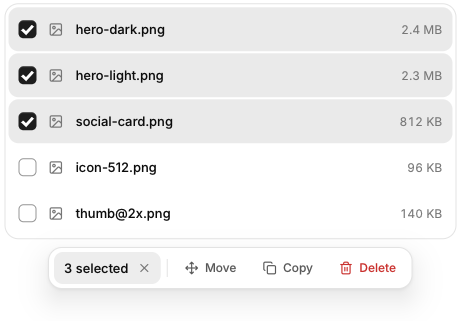

# Selection bar

Use a selection bar for bulk operations. The gallery shows a selected
file count and actions beneath the file list.
Available in **GUI**.



## Example

```pascal
unit Docs.Ui.CanvasAndBars.SelectionBar;

uses Fpas.Ui.Elements as E, Fpas.Ui.Widgets.Canvas.SelectionBars as W;

// Adds a bulk action bar to a list.
// ## Parameters
// - `Child`: List that anchors the floating bar.
// - `Selected`: Selection flags in the list's order.
// - `Actions`: Action glyphs, captions and tones in display order.
// ## Returns
// The list with bulk action and clear proposals.
public function View(
  Child: E.Element<W.Event>;
  Selected: array of bool;
  Actions: array of W.Action
): E.Element<W.Event>;
begin
  return W.SelectionBar<W.Event>('bulk-files', Selected, Actions,
    function(Change: W.Event): W.Event => Change, Child);
end function;

end unit;
```

## Options and defaults

| Option | Default or requirement |
| --- | --- |
| `Selected / Actions` | Supply the current flags and ordered actions. The bar appears when items are selected. |
| `NoEscape / Enabled` | false / true. NoEscape keeps selection when Escape is pressed. |

## Interaction

Use `Event.Index` to resolve the action and apply it to the selected
items. When `Clear` is true, clear the flags in the model.

## See also

- [Widget API and types](../../../src/Fpas.Ui/Widgets/Canvas/SelectionBars.fpas)
- [Gallery example](../../../examples/ui/gui/gallery/Pages/Canvas/View.fpas)
- [Canvas and bars](README.md)
