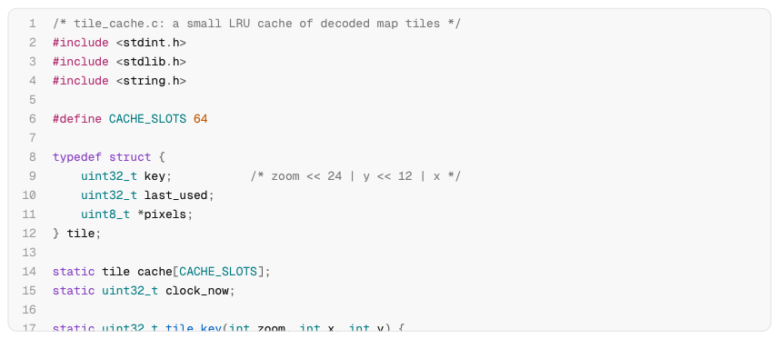
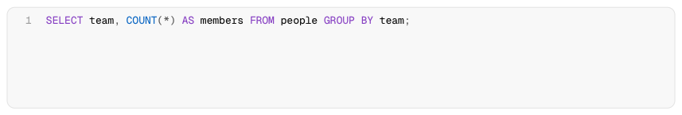

# Code editor

Use a code editor to edit source with highlighting and line numbers. It
reports the caret position to the application. The gallery shows a C tile
cache and an editable SQL query.
Available in **GUI**.



## Example

```pascal
unit Docs.Ui.Code.CodeEditor;

uses Fpas.Ui.Elements as E, Fpas.Ui.Widgets.Editors.CodeEditors as W;

// Edits a query stored in the application model.
// ## Parameters
// - `Source`: Current query text.
// ## Returns
// The editor with changes and caret position as messages.
public function View(Source: string): E.Element<W.Event>;
begin
  return W.CodeEditor<W.Event>('sql-editor', Source,
    function(Change: W.Event): W.Event => Change,
    new W.Options(Language := 'sql', Height := 128.0F));
end function;

end unit;
```

## Options and defaults

| Option | Default or requirement |
| --- | --- |
| `Language / Placeholder` | text / empty. Choose a CUI syntax name such as c or sql. |
| `Width / Height / Size` | Fill / 0 / 0. Zero uses native height or font size. A height of minus one fills the viewport. |
| `Capacity / TabSize / UseTabs` | 65,536 UTF-8 bytes including the terminator / 4 / false. |
| `LineNumbers / ReadOnly` | true / false. ReadOnly allows selection and find. |

## Interaction

Store the new source when `Event.Text` has a value. An event may also
report only caret position and line count. Lines and columns start at one.
`Refused` reports an edit that exceeded the UTF-8 capacity. Replacing the
source from outside the editor resets its undo history.



## See also

- [Widget API and types](../../../src/Fpas.Ui/Widgets/Editors/CodeEditors.fpas)
- [Gallery example](../../../examples/ui/gui/gallery/Pages/Code/Tools.fpas)
- [Code block](code-block.md)
- [Code](README.md)
