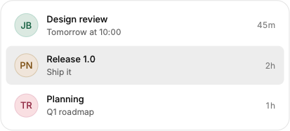

# List item

Use a list item for a row with a title and optional secondary information. Available in **GUI**.



## Example

```pascal
unit Docs.Ui.DataDisplay.ListItem;

uses Fpas.Ui.Elements as E, Fpas.Ui.Widgets.Collections.ListItems as W;

// Builds the list item example.
// ## Parameters
// - `Selected`: Current value from the application model.
// ## Returns
// The widget for the application view.
public function View(Selected: bool): E.Element<string>;
begin
  return W.ListItem<string>('design-review', 'Design review',
    function(): string => 'open-review',
    new W.Options(Subtitle := 'Tomorrow at 10:00', Avatar := 'Jonas Berg', Trailing := '45m',
      Selected := Selected));
end function;

end unit;
```

## Options and defaults

| Option | Default or requirement |
| --- | --- |
| `Subtitle / Trailing` | Empty. Use Trailing for short text such as a duration. |
| `Avatar / Icon` | Empty. Supply a name to display initials or a CUI glyph for an icon. |
| `Selected / Enabled` | false / true. |
| `OnActivate` | Optional message factory. |

## Interaction

An enabled row with an action accepts a click, Enter or Space while focused. The application decides whether to change selection. Omit the callback for a passive row like the gallery's examples.

## See also

- [Widget API and types](../../../src/Fpas.Ui/Widgets/Collections/ListItems.fpas)
- [Gallery example](../../../examples/ui/gui/gallery/Pages/Lists/Widgets/TreeAndList.fpas)
- [Tree](tree.md)
- [Avatar](../disclosure/avatar.md)
- [Data display](README.md)
