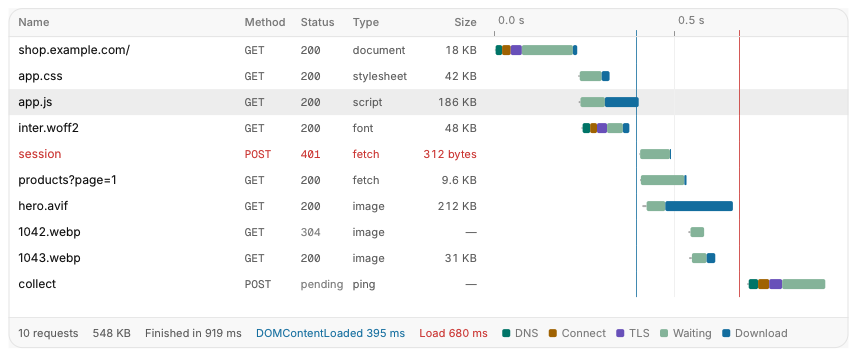

# Network waterfall

Use a network waterfall to compare HTTP request timings. The gallery
marks DOMContentLoaded and load on the shared time scale.
Available in **GUI**.



## Example

```pascal
unit Docs.Ui.DeveloperTools.NetworkWaterfall;

uses Fpas.Ui.Elements as E, Fpas.Ui.Widgets.Developer.NetworkWaterfalls as W;

// Displays timing data collected by the application.
// ## Parameters
// - `Requests`: Captured requests and phase durations.
// - `Selected`: Selected request index, or minus one.
// ## Returns
// The waterfall with selected and activated requests as proposals.
public function View(Requests: array of W.Request; Selected: int): E.Element<W.Event>;
begin
  return W.NetworkWaterfall<W.Event>('network', Requests, Selected,
    function(Change: W.Event): W.Event => Change,
    new W.Options(Height := 340.0F, DomLoaded := 0.395, Loaded := 0.68));
end function;

end unit;
```

## Options and defaults

| Option | Default or requirement |
| --- | --- |
| `Start / Queued / Dns / Connect / Tls / Wait / Download` | Pass seconds relative to the start of the page for Start and durations in seconds for the phases. |
| `Status / Type / Size` | Use status zero when pending or failed. Type can be null. Size is the number of bytes transferred. |
| `DomLoaded / Loaded` | Both zero. A positive time in seconds draws its marker. |
| `Width / Height / Enabled` | Fill / 0 / true. Zero uses the native height. |

## Interaction

Hover a bar for timing details. Up and Down move selection. Double-click
or press Enter to activate a request. Map `Selection`, `Clicked` and
`Activated` to the original request array. Minus one means no item.

## See also

- [Widget API and types](../../../src/Fpas.Ui/Widgets/Developer/NetworkWaterfalls.fpas)
- [Gallery example](../../../examples/ui/gui/gallery/Pages/Developer/View.fpas)
- [HTTP request bar](../more-developer-tools/http-request-bar.md)
- [Developer tools](README.md)
