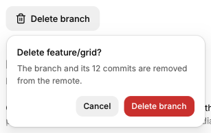

# Confirm popover

Use a confirm popover for a short question next to the action that opened it. Available in **GUI**.



## Example

```pascal
unit Docs.Ui.Disclosure.ConfirmPopover;

uses Fpas.Ui.Elements as E,
  Fpas.Ui.Widgets.Overlays.ConfirmPopovers as W,
  Fpas.Ui.Widgets.Actions.Buttons as B;

// Builds the confirm popover example.
// ## Parameters
// - `Open`: Current visibility from the application model.
// ## Returns
// The widget for the application view.
public function View(Open: bool): E.Element<string>;
begin
  return W.ConfirmPopover<string>('branch-question',
    B.Button<string>('branch-trigger', 'Delete branch', 'ask-delete'), Open,
    new W.Options('Delete feature/grid?', ConfirmLabel := 'Delete branch', Danger := true),
    'delete-branch', 'cancel-delete');
end function;

end unit;
```

## Options and defaults

| Option | Default or requirement |
| --- | --- |
| `Title / Description` | Title is required. Description defaults to empty. |
| `ConfirmLabel / CancelLabel` | Confirm / Cancel. |
| `Danger / Position` | false / BottomStart. Set Danger for destructive intent. |

## Interaction

The trigger opens the question in the model. The confirm action receives focus and requires a separate activation. Cancel, Escape or a press outside sends the dismiss message. Close the question in your update for either outcome. Use `ConfirmId` and `CancelId` to inspect the built-in buttons.

## See also

- [Widget API and types](../../../src/Fpas.Ui/Widgets/Overlays/ConfirmPopovers.fpas)
- [Gallery example](../../../examples/ui/gui/gallery/Pages/Disclosure/Widgets/ConfirmPopover.fpas)
- [Popover](../overlays/popover.md)
- [Dialog](../overlays/dialog.md)
- [Disclosure](README.md)
