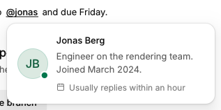

# Hover card

Use a hover card for a preview anchored to an interactive control. The gallery opens a profile preview over the @jonas link. Available in **GUI**.



## Example

```pascal
unit Docs.Ui.Disclosure.HoverCard;

uses Fpas.Ui.Elements as E,
  Fpas.Ui.Widgets.Overlays.HoverCards as W,
  Fpas.Ui.Widgets.Display.Links as L;

// Builds the hover card example.
// ## Parameters
// - `Content`: Current value from the application model.
// ## Returns
// The widget for the application view.
public function View(Content: E.Element<string>): E.Element<string>;
begin
  return W.HoverCard<string>('jonas-card', L.Link<string>('jonas-link', '@jonas', 'open-profile'), Content);
end function;

end unit;
```

## Options and defaults

| Option | Default or requirement |
| --- | --- |
| `Position / Width` | BottomStart / 300 logical points. |
| `Delay` | 0.45 seconds. |
| `Enabled` | true. |

## Interaction

Rest the pointer on the link to open the card after the delay. It remains open while the pointer is over the trigger or the card. Escape dismisses it until the pointer leaves the trigger. The link still sends its own activation message.

## See also

- [Widget API and types](../../../src/Fpas.Ui/Widgets/Overlays/HoverCards.fpas)
- [Gallery example](../../../examples/ui/gui/gallery/Pages/Disclosure/Widgets/HoverCard.fpas)
- [Link](link.md)
- [Avatar](avatar.md)
- [Disclosure](README.md)
