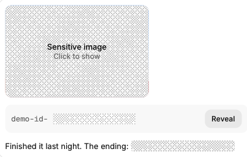
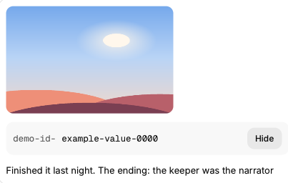

# Veil

Use a veil to visually cover a picture or spoiler until the user reveals it. Available in **GUI**.





## Example

```pascal
unit Docs.Ui.Disclosure.Veil;

uses Fpas.Ui.Elements as E,
  Fpas.Ui.Widgets.Overlays.Veils as W;

// Builds the veil example.
// ## Parameters
// - `Shown`: Current reveal state.
// ## Returns
// The widget for the application view.
public function View(Shown: bool): E.Element<bool>;
begin
  return W.Veil<bool>('spoiler', Shown, function(Value: bool): bool => Value,
    E.Text<bool>('The keeper was the narrator.'),
    new W.Options(Label := 'Spoiler', Hint := 'Click to show', Toggle := true, Radius := 4.0F));
end function;

end unit;
```

## Options and defaults

| Option | Default or requirement |
| --- | --- |
| `Revealed` | Pass the current visibility flag from the model. |
| `Label / Hint` | null / null. Add optional text to the cover. |
| `Toggle / Radius` | false / 0. Enable Toggle to allow activation to cover the content again. |
| `Color / Width / Enabled` | null / Content / true. |

## Interaction

Click the covered area or activate it with Enter when focused to propose a reveal. Accept the proposal in the model. The cover is a visual effect. Keep sensitive data out of the view when the user lacks access.

## See also

- [Widget API and types](../../../src/Fpas.Ui/Widgets/Overlays/Veils.fpas)
- [Gallery example](../../../examples/ui/gui/gallery/Pages/Disclosure/Widgets/Veil.fpas)
- [Disclosure](README.md)
