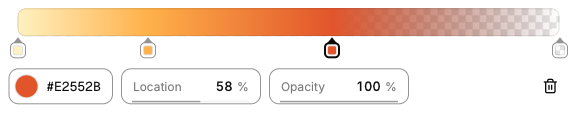

# Gradient editor

Use a gradient editor to set colors and opacity along a ramp. The gallery
shows how flame color changes over its lifetime. Available in **GUI**.



## Example

```pascal
unit Docs.Ui.EditingTools.GradientEditor;

uses Fpas.Ui.Elements as E, Fpas.Ui.Graphics as G,
  Fpas.Ui.Widgets.Editors.GradientEditors as W;

// Defines a ramp with an opaque start and transparent end.
// ## Returns
// The initial stops for the model.
public function InitialStops(): array of W.Stop;
begin
  return [new W.Stop(0.0F, new G.Color($FF, $DC, $83)),
    new W.Stop(1.0F, new G.Color($62, $12, $0F, $00))];
end function;

// Edits the current color ramp.
// ## Parameters
// - `Stops`: Model-owned stops sorted by position.
// - `Selected`: Selected stop index, or minus one.
// ## Returns
// The editor with color, position and selection proposals.
public function View(Stops: array of W.Stop; Selected: int): E.Element<W.Event>;
begin
  return W.GradientEditor<W.Event>('flame-ramp', Stops, Selected,
    function(Change: W.Event): W.Event => Change, new W.Options(Capacity := 12));
end function;

end unit;
```

## Options and defaults

| Option | Default or requirement |
| --- | --- |
| `Stop.Position / Tint` | Supply a position from zero through one and straight RGBA, including opacity. |
| `Selected` | Pass minus one for no selection. |
| `Width / Height / Capacity` | Fill / 0 / 16. Zero height uses the native ramp height. |

## Interaction

Drag stops or use Left and Right on a focused stop. Double-click a stop or
press Enter to open the color picker. Delete removes a focused stop when
enough stops remain. Store the proposed sorted stops and selected index to
accept edits.

## See also

- [Widget API and types](../../../src/Fpas.Ui/Widgets/Editors/GradientEditors.fpas)
- [Gallery example](../../../examples/ui/gui/gallery/Pages/EditingTools/View.fpas)
- [Color picker](../inputs/color-picker.md)
- [Editing tools](README.md)
