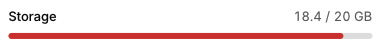

# Meter

Use a meter for usage relative to a capacity. The gallery shows storage in gigabytes. Available in **GUI**.



## Example

```pascal
unit Docs.Ui.Feedback.Meter;

uses Fpas.Ui.Elements as E, Fpas.Ui.Widgets.Charts.Meters as W;

// Builds the meter example.
// ## Parameters
// - `Used`: Current usage in gigabytes.
// ## Returns
// The widget for the application view.
public function View(Used: float): E.Element<string>;
begin
  return W.Meter<string>('storage-usage', 'Storage', Used, 20.0F, 'GB');
end function;

end unit;
```

## Options and defaults

| Option | Default or requirement |
| --- | --- |
| `Label / Unit` | Literal text. Unit defaults to empty. |
| `Used / Total` | Finite nonnegative quantities. Used can exceed Total. |

## Interaction

CUI formats the quantities and applies its warning and danger colors. A zero total shows an empty track. Usage above capacity fills the track while the displayed amounts remain accurate. The meter is read-only.

## See also

- [Widget API and types](../../../src/Fpas.Ui/Widgets/Charts/Meters.fpas)
- [Gallery example](../../../examples/ui/gui/gallery/Pages/Feedback/View.fpas)
- [Progress bar](progress-bar.md)
- [Feedback](README.md)
