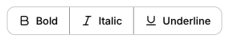

# Button group

Join related actions in a single horizontal frame with dividers. Available in **GUI**.



## Example

```pascal
unit Docs.Ui.Actions.ButtonGroup;

uses Fpas.Ui.Elements as E, Fpas.Ui.Widgets.Actions.ButtonGroups as G,
  Fpas.Ui.Widgets.Actions.Buttons as B;

// Builds the example view.
// ## Returns
// The widget with its message type.
public function View(): E.Element<string>;
begin
  return G.ButtonGroup<string>(
    B.Button<string>('bold', 'Bold', 'bold'),
    B.Button<string>('italic', 'Italic', 'italic')
  );
end function;

end unit;
```

## Options and defaults

| Option | Default or requirement |
| --- | --- |
| `Children` | Direct buttons, including icon, copy and hold buttons. Each child supplies its own options. |

## Interaction

Pass direct button children in display order. Each keeps its own message,
state, and focus stop. Default-styled buttons use the ghost appearance
inside a group.

## See also

- [Widget API and types](../../../../src/Fpas.Ui/Widgets/Actions/ButtonGroups.fpas)
- [Gallery example](../../../../examples/ui/gui/gallery/Pages/Buttons/Widgets/ButtonGroup.fpas)
- [Actions](README.md)
