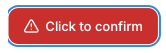

# Confirm button

Ask for a second activation before carrying out a destructive action. Available in **GUI**.



## Example

```pascal
unit Docs.Ui.Actions.ConfirmButton;

uses Fpas.Ui.Elements as E;
uses Fpas.Ui.Widgets.Actions.ConfirmButtons as C;

// Builds the example view.
// ## Returns
// The widget with its message type.
public function View(): E.Element of string;
begin
  return C.ConfirmButton of string('delete', 'Delete project', 'delete',
    new C.Options(ConfirmLabel := 'Confirm deletion'));
end function;

end unit;
```

## Options and defaults

| Option | Default or requirement |
| --- | --- |
| `ConfirmLabel` | Click to confirm |
| `TimeoutMilliseconds` | 3000 |
| `Variant / ControlSize / Enabled` | Secondary / Medium / true |

## Interaction

The first click, Enter or Space arms the button. The second activation
within the time limit sends its message once. Escape, clicking outside or
letting the limit expire disarms it.

## See also

- [CUI widget inventory](../../../cui-widget-inventory.md#cui_confirm_button)
- [Widget API and types](../../../../src/Fpas.Ui/Widgets/Actions/ConfirmButtons.fpas)
- [Gallery example](../../../../examples/ui/gui/gallery/Pages/Actions/Widgets/ConfirmButton.fpas)
- [Actions](README.md)

## Source files

- `src/Fpas.Ui.Gui/Internal/Widgets/Actions/`
  - [ConfirmButton.fpas](../../../../src/Fpas.Ui.Gui/Internal/Widgets/Actions/ConfirmButton.fpas)
- `src/Fpas.Ui.Gui.Cui/Interop/Actions/`
  - [NativeMethods.ConfirmButton.cs](../../../../src/Fpas.Ui.Gui.Cui/Interop/Actions/NativeMethods.ConfirmButton.cs)
- `src/Fpas.Ui.Gui.Cui/Widgets/Actions/`
  - [CuiWindow.ConfirmButton.Types.cs](../../../../src/Fpas.Ui.Gui.Cui/Widgets/Actions/CuiWindow.ConfirmButton.Types.cs)
  - [CuiWindow.ConfirmButton.cs](../../../../src/Fpas.Ui.Gui.Cui/Widgets/Actions/CuiWindow.ConfirmButton.cs)
- `src/Fpas.Ui.Gui.Cui/native/tests/`
  - [confirm_button.c](../../../../src/Fpas.Ui.Gui.Cui/native/tests/confirm_button.c)
- `src/Fpas.Ui.Gui.Cui/native/widgets/actions/`
  - [confirm_button.c](../../../../src/Fpas.Ui.Gui.Cui/native/widgets/actions/confirm_button.c)
  - [confirm_button.h](../../../../src/Fpas.Ui.Gui.Cui/native/widgets/actions/confirm_button.h)
- `tests/Fpas.Ui.Gui.Cui.Tests/Actions/`
  - [CuiConfirmButtonTests.cs](../../../../tests/Fpas.Ui.Gui.Cui.Tests/Actions/CuiConfirmButtonTests.cs)
