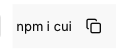

# Copy button

Send literal text to the clipboard and show brief feedback next to the copied value. Available in **GUI**.



## Example

```pascal
unit Docs.Ui.Actions.CopyButton;

uses Fpas.Ui.Elements as E;
uses Fpas.Ui.Widgets.Actions.CopyButtons as C;

// Builds the example view.
// ## Returns
// The widget with its message type.
public function View(): E.Element of string;
begin
  return C.CopyButton of string('copy-install', 'npm i cui');
end function;

end unit;
```

## Options and defaults

| Option | Default or requirement |
| --- | --- |
| `OnCopied` | Absent by default |
| `Enabled` | true |

## Interaction

Click, Enter or Space submits the text. The check mark lasts 1.6 seconds and
focus stays on the button. GUI uses the platform clipboard. The optional callback
reports submission.
The host disables the control when the platform clipboard is unavailable.

## See also

- [CUI widget inventory](../../../cui-widget-inventory.md#cui_copy_button)
- [Widget API and types](../../../../src/Fpas.Ui/Widgets/Actions/CopyButtons.fpas)
- [Gallery example](../../../../examples/ui/gui/gallery/Pages/Buttons/Widgets/CopyButton.fpas)
- [Formatted text](../text-and-display/formatted-text.md)
- [Actions](README.md)

## Source files

- `src/Fpas.Ui.Gui/Internal/Widgets/Actions/`
  - [CopyButton.fpas](../../../../src/Fpas.Ui.Gui/Internal/Widgets/Actions/CopyButton.fpas)
- `src/Fpas.Ui.Gui.Cui/Interop/Actions/`
  - [NativeMethods.CopyButton.cs](../../../../src/Fpas.Ui.Gui.Cui/Interop/Actions/NativeMethods.CopyButton.cs)
- `src/Fpas.Ui.Gui.Cui/Widgets/Actions/`
  - [CuiWindow.CopyButton.cs](../../../../src/Fpas.Ui.Gui.Cui/Widgets/Actions/CuiWindow.CopyButton.cs)
- `src/Fpas.Ui.Gui.Cui/native/widgets/actions/`
  - [copy_button.c](../../../../src/Fpas.Ui.Gui.Cui/native/widgets/actions/copy_button.c)
  - [copy_button.h](../../../../src/Fpas.Ui.Gui.Cui/native/widgets/actions/copy_button.h)
