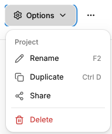

# Dropdown menu

Open a list of commands from a labeled or icon-only trigger. Available in **GUI** and [TUI](../../tui/actions/dropdown-menu.md).



## Example

```pascal
unit Docs.Ui.Actions.DropdownMenu;

uses Fpas.Ui.Elements as E;
uses Fpas.Ui.Widgets.Overlays.Menus as M;

// Builds the example view.
// ## Returns
// The widget with its message type.
public function View(): E.Element of string;
begin
  return M.Menu of string('options', 'Options', [
    (M.Entry of string).Label('Project'),
    (M.Entry of string).Action(new M.Item of string('rename', 'Rename', 'rename')),
    (M.Entry of string).Separator,
    (M.Entry of string).Action(new M.Item of string('delete', 'Delete', 'delete', Danger := true))
  ]);
end function;

end unit;
```

## Options and defaults

| Option | Default or requirement |
| --- | --- |
| `Variant` | Default resolves to secondary for a labeled trigger and ghost for an icon-only trigger |
| `Icon` | Empty. An icon-only trigger uses the native ellipsis when no icon is set. |
| `IconOnly / Enabled` | false / true |
| `Position` | BottomStart |
| `Width` | 0 uses content sizing with a 180-point minimum in GUI |

Each command has a key, caption, and message. `Icon` and `Shortcut` default to
empty. `Enabled` defaults to true. `Danger` and `Checked` default to false.
In the GUI, `Font` defaults to `Body`. `TextSize` uses logical units and defaults
to zero for the theme body size. A larger caption can increase the row height.

## Interaction

Click the trigger or press Enter, Space, or Down when it has focus. Up and Down
move the menu highlight. Press Enter on an enabled command to choose it.
Press Escape to close the menu. Command keys stay stable when captions change.
Section labels and separators have no action. Shortcut text displays a hint.

## See also

- [CUI widget inventory](../../../cui-widget-inventory.md#cui_menu)
- [Widget API and types](../../../../src/Fpas.Ui/Widgets/Overlays/Menus.fpas)
- [Gallery example](../../../../examples/ui/gui/gallery/Pages/Buttons/Widgets/DropdownMenu.fpas)
- [Actions](README.md)

## Source files

- [Shared Options example](../../../../examples/ui/gui/gallery/Shared/ProjectOptions.fpas)

- [DropdownMenu.fpas](../../../../src/Fpas.Ui.Gui/Internal/Widgets/Overlays/DropdownMenu.fpas)
- [Menu.fpas](../../../../src/Fpas.Ui.Gui/Internal/Widgets/Overlays/Menu.fpas)
- [DropdownContract.fpas](../../../../tests/Fixtures/gui-host/DropdownContract.fpas)
