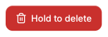

# Hold to confirm

Require a deliberate hold before a destructive or hard-to-undo action. Available in **GUI**.



## Example

```pascal
unit Docs.Ui.Actions.HoldButton;

uses Fpas.Ui.Elements as E, Fpas.Ui.Widgets.Actions.HoldButtons as H;

// Builds the example view.
// ## Returns
// The widget with its message type.
public function View(): E.Element<string>;
begin
  return H.HoldButton<string>('delete', 'Hold to delete', 'delete');
end function;

end unit;
```

## Options and defaults

| Option | Default or requirement |
| --- | --- |
| `DurationMilliseconds` | 1200 |
| `Variant` | Destructive |
| `Icon` | Empty |
| `Enabled` | true |

## Interaction

GUI sends the message once as soon as a pointer, Enter or Space hold
completes.

## See also

- [Widget API and types](../../../../src/Fpas.Ui/Widgets/Actions/HoldButtons.fpas)
- [Gallery example](../../../../examples/ui/gui/gallery/Pages/Buttons/Widgets/HoldButton.fpas)
- [Actions](README.md)
