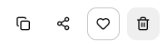

# Icon button

Use a glyph for a compact, familiar action. Give it a tooltip that names the action. Available in **GUI**.



## Example

```pascal
unit Docs.Ui.Actions.IconButton;

uses Fpas.Ui.Elements as E;
uses Fpas.Ui.Widgets.Actions.IconButtons as B;
uses System as Sys;

// Builds the example view.
// ## Returns
// The widget with its message type.
public function View(): E.Element of string;
begin
  return B.IconButton of string('share', Sys.Char.ConvertFromUtf32($E156),
    'Share', 'share');
end function;

end unit;
```

## Options and defaults

| Option | Default or requirement |
| --- | --- |
| `Variant / ControlSize` | Ghost / Medium. Small and Large are also available. |
| `Enabled / Loading / Selected` | true / false / false |
| `Tooltip` | Required. Names the action. Use a nonblank caption without the middle-dot delimiter with two spaces on each side. |
| `Shortcut` | Empty. The caption and shortcut must fit 255 UTF-8 bytes, including six separator bytes for the shortcut. |
| `Width` | Content uses the native square size. Fill, Fixed, and Percent set the width. |
| `Color` | null. The button variant supplies the glyph and busy indicator color. |

Use `Elements.Size` with a width growth weight to allocate a weighted share of a
GUI row. [Sizing and units](../../layout/sizing.md#independent-gui-axes)

## Interaction

Tab focuses the button. Click, Enter or Space sends its message. Busy
buttons keep focus and suppress activation. The GUI uses the CUI icon font.
Shortcut displays a hint in the tooltip. Bind the key separately.

## See also

- [CUI widget inventory](../../../cui-widget-inventory.md#cui_icon_button)
- [Widget API and types](../../../../src/Fpas.Ui/Widgets/Actions/IconButtons.fpas)
- [Gallery example](../../../../examples/ui/gui/gallery/Pages/Buttons/View.fpas)
- [Tooltip toolbar](../../../../examples/ui/gui/gallery/Pages/Overlays/Widgets/Tooltip.fpas)
- [Actions](README.md)

## Source files

- `src/Fpas.Ui.Gui/Internal/Widgets/Actions/`
  - [IconButton.fpas](../../../../src/Fpas.Ui.Gui/Internal/Widgets/Actions/IconButton.fpas)
- `src/Fpas.Ui.Gui.Cui/Interop/Actions/`
  - [NativeMethods.IconButton.cs](../../../../src/Fpas.Ui.Gui.Cui/Interop/Actions/NativeMethods.IconButton.cs)
- `src/Fpas.Ui.Gui.Cui/Widgets/Actions/`
  - [CuiWindow.IconButton.cs](../../../../src/Fpas.Ui.Gui.Cui/Widgets/Actions/CuiWindow.IconButton.cs)
- `src/Fpas.Ui.Gui.Cui/native/tests/`
  - [icon_button.c](../../../../src/Fpas.Ui.Gui.Cui/native/tests/icon_button.c)
- `src/Fpas.Ui.Gui.Cui/native/widgets/actions/`
  - [icon_button.c](../../../../src/Fpas.Ui.Gui.Cui/native/widgets/actions/icon_button.c)
  - [icon_button.h](../../../../src/Fpas.Ui.Gui.Cui/native/widgets/actions/icon_button.h)
