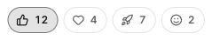

# Reactions

Show counts and the current user's reaction alongside a message or activity. Available in **GUI**.



## Example

```pascal
unit Docs.Ui.Actions.Reactions;

uses Fpas.Ui.Elements as E;
uses Fpas.Ui.Widgets.Conversation.Reactions as R;

// The reaction and its position after activation.
public type Change = record
  // Zero-based position in the displayed list.
  public Index: int;
  // Proposed count and selected state.
  public Item: R.Item;
end record;

// Builds the example view.
// ## Parameters
// - `Items`: Current application value.
// ## Returns
// The widget with its message type.
public function View(Items: array of R.Item): E.Element of Change;
begin
  return R.Reactions of Change('votes', Items,
    function(Index: int; Item: R.Item): Change => new Change(Index, Item));
end function;

end unit;
```

## Options and defaults

| Option | Default or requirement |
| --- | --- |
| `Id` | Stable group ID. |
| `Items` | Reactions in display order. An empty group has no pills. |
| `Item.Label` | Single-line name for inspection. |
| `Item.Icon` | CUI glyph. Pass null for a count-only pill. |
| `Item.Count` | Nonnegative count. An inactive item needs room for one increment. |
| `Item.Active` | false. Set to true if the user has reacted. |
| `Enabled` | true. A disabled group keeps its appearance without accepting activation. |

## Interaction

Click a reaction or press Enter or Space when it has focus. Activation adds
one to the count and deactivation subtracts one. The count stays at or above
zero. The mapper gets the zero-based index and proposed item. Store that item
in the model to apply its count and active flag. CUI animates count changes.
Use `ItemId` to request focus for a particular reaction.

## See also

- [CUI widget inventory](../../../cui-widget-inventory.md#cui_reactions)
- [Widget API and types](../../../../src/Fpas.Ui/Widgets/Conversation/Reactions.fpas)
- [Gallery example](../../../../examples/ui/gui/gallery/Pages/Actions/Widgets/Reactions.fpas)
- [Actions](README.md)

## Source files

- `src/Fpas.Ui.Gui/Internal/Widgets/Conversation/`
  - [Reactions.fpas](../../../../src/Fpas.Ui.Gui/Internal/Widgets/Conversation/Reactions.fpas)
- `src/Fpas.Ui.Gui.Cui/Interop/Conversation/`
  - [NativeMethods.Reactions.cs](../../../../src/Fpas.Ui.Gui.Cui/Interop/Conversation/NativeMethods.Reactions.cs)
- `src/Fpas.Ui.Gui.Cui/Widgets/Conversation/`
  - [CuiWindow.Reactions.Types.cs](../../../../src/Fpas.Ui.Gui.Cui/Widgets/Conversation/CuiWindow.Reactions.Types.cs)
  - [CuiWindow.Reactions.cs](../../../../src/Fpas.Ui.Gui.Cui/Widgets/Conversation/CuiWindow.Reactions.cs)
- `src/Fpas.Ui.Gui.Cui/native/widgets/conversation/`
  - [reactions.c](../../../../src/Fpas.Ui.Gui.Cui/native/widgets/conversation/reactions.c)
  - [reactions.h](../../../../src/Fpas.Ui.Gui.Cui/native/widgets/conversation/reactions.h)
