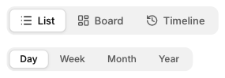

# Segmented control

Choose one view or filter from a compact row of alternatives. Available in **GUI**.



## Example

```pascal
unit Docs.Ui.Actions.SegmentedControl;

uses Fpas.Ui.Elements as E, Fpas.Ui.Widgets.Actions.SegmentedControls as S;

// Builds the example view.
// ## Parameters
// - `Selected`: Current application value.
// ## Returns
// The widget with its message type.
public function View(Selected: int): E.Element<int>;
begin
  return S.SegmentedControl<int>('view', [new S.Item('List'), new S.Item('Board')],
    Selected, function(Index: int): int => Index);
end function;

end unit;
```

## Options and defaults

| Option | Default or requirement |
| --- | --- |
| `ControlSize / FullWidth / Enabled` | Medium / false / true |
| `Item.Icon` | Empty |
| `Item.IconOnly` | false |

## Interaction

Supply one to 32 choices and a model-owned, zero-based selected index. Tab
moves focus. Left and Right propose the adjacent choice without wrapping.
Click, Enter or Space chooses the focused segment. Activating the selected
segment leaves the model alone.

## See also

- [Widget API and types](../../../../src/Fpas.Ui/Widgets/Actions/SegmentedControls.fpas)
- [Gallery example](../../../../examples/ui/gui/gallery/Pages/Buttons/Widgets/SegmentedControl.fpas)
- [Actions](README.md)
