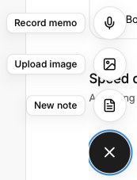

# Speed dial

Group closely related commands behind one floating action button. Available in **GUI**.



## Example

```pascal
unit Docs.Ui.Actions.SpeedDial;

uses Fpas.Ui.Elements as E, Fpas.Ui.Widgets.Actions.SpeedDials as D,
  System as Sys;

// Builds the example view.
// ## Returns
// The widget with its message type.
public function View(): E.Element<int>;
begin
  return D.SpeedDial<int>('create', [
    new D.Item('New note', Sys.Char.ConvertFromUtf32($E0CC)),
    new D.Item('Upload image', Sys.Char.ConvertFromUtf32($E0F6))
  ], function(Index: int): int => Index, new D.Options(Tooltip := 'Create'));
end function;

end unit;
```

## Options and defaults

| Option | Default or requirement |
| --- | --- |
| `Items` | 1 to 16 captions with CUI glyphs |
| `Icon / Tooltip` | Both empty by default |
| `Position / Enabled` | BottomStart / true |

## Interaction

Click or Enter opens the dial. Choosing a visible action sends its zero-
based index. Escape closes the dial and restores focus to the trigger. Use
ItemId to focus or inspect a visible action.

## See also

- [Widget API and types](../../../../src/Fpas.Ui/Widgets/Actions/SpeedDials.fpas)
- [Gallery example](../../../../examples/ui/gui/gallery/Pages/Actions/Widgets/SpeedDial.fpas)
- [Actions](README.md)
