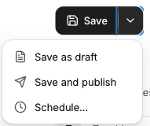

# Split button

Put the primary action and related commands on the same control. Available in **GUI**.



## Example

```pascal
unit Docs.Ui.Actions.SplitButton;

uses Fpas.Ui.Elements as E, Fpas.Ui.Widgets.Actions.SplitButtons as S;

// Builds the example view.
// ## Returns
// The widget with its message type.
public function View(): E.Element<string>;
begin
  return S.SplitButton<string>('save', 'Save', 'save', [
    new S.Item<string>('draft', 'Save as draft', 'draft'),
    new S.Item<string>('publish', 'Save and publish', 'publish')
  ]);
end function;

end unit;
```

## Options and defaults

| Option | Default or requirement |
| --- | --- |
| `Variant / ControlSize` | Primary / Medium |
| `Icon` | Empty |
| `Enabled` | true |

## Interaction

Tab visits the main action and the chevron separately. Down on the chevron
opens the menu. Use arrows and Enter to choose a command, or Escape to
dismiss. Closing the menu restores focus to the chevron. Use unique keys for
the nonempty set of commands.

## See also

- [Widget API and types](../../../../src/Fpas.Ui/Widgets/Actions/SplitButtons.fpas)
- [Gallery example](../../../../examples/ui/gui/gallery/Pages/Actions/Widgets/SplitButton.fpas)
- [Actions](README.md)

## Source files

- `src/Fpas.Ui.Gui/Internal/Widgets/Actions/`
  - [SplitButton.fpas](../../../../src/Fpas.Ui.Gui/Internal/Widgets/Actions/SplitButton.fpas)
- `src/Fpas.Ui.Gui.Cui/Interop/Actions/`
  - [NativeMethods.SplitButton.cs](../../../../src/Fpas.Ui.Gui.Cui/Interop/Actions/NativeMethods.SplitButton.cs)
- `src/Fpas.Ui.Gui.Cui/Widgets/Actions/`
  - [CuiWindow.SplitButton.Types.cs](../../../../src/Fpas.Ui.Gui.Cui/Widgets/Actions/CuiWindow.SplitButton.Types.cs)
  - [CuiWindow.SplitButton.cs](../../../../src/Fpas.Ui.Gui.Cui/Widgets/Actions/CuiWindow.SplitButton.cs)
- `src/Fpas.Ui.Gui.Cui/native/widgets/actions/`
  - [split_button.c](../../../../src/Fpas.Ui.Gui.Cui/native/widgets/actions/split_button.c)
  - [split_button.h](../../../../src/Fpas.Ui.Gui.Cui/native/widgets/actions/split_button.h)
