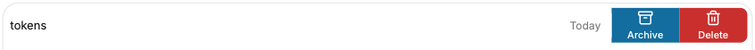

# Swipe actions

Reveal actions next to a list row without taking up space in its resting layout. Available in **GUI**.




## Example

```pascal
unit Docs.Ui.Actions.SwipeActions;

uses Fpas.Ui.Elements as E, Fpas.Ui.Widgets.Actions.SwipeActions as S,
  Fpas.Ui.Styles as Style;

// Builds the example view.
// ## Returns
// The widget with its message type.
public function View(): E.Element<int>;
begin
  return S.SwipeItem<int>('task', E.Text<int>('Review the design tokens'), [],
    [new S.Item('Archive', Tone := Style.Tone.Info)],
    function(At: S.Side; Index: int): int => Index);
end function;

end unit;
```

## Options and defaults

| Option | Default or requirement |
| --- | --- |
| `Item.Icon / Item.Tone` | Empty / Neutral |
| `Options.Icon / Options.Detail` | Both empty |
| `Options.Enabled` | true |

## Interaction

Drag the row sideways with the pointer or scroll horizontally over it to
reveal the actions. The callback receives the revealed side and zero-based
index when an action is chosen. Provide another way to reach the commands if
the app needs keyboard-only operation.

## See also

- [Widget API and types](../../../../src/Fpas.Ui/Widgets/Actions/SwipeActions.fpas)
- [Gallery example](../../../../examples/ui/gui/gallery/Pages/Actions/Widgets/SwipeActions.fpas)
- [Actions](README.md)

## Source files

- `src/Fpas.Ui.Gui/Internal/Widgets/Actions/`
  - [SwipeItem.fpas](../../../../src/Fpas.Ui.Gui/Internal/Widgets/Actions/SwipeItem.fpas)
- `src/Fpas.Ui.Gui.Cui/Interop/Actions/`
  - [NativeMethods.SwipeItem.cs](../../../../src/Fpas.Ui.Gui.Cui/Interop/Actions/NativeMethods.SwipeItem.cs)
- `src/Fpas.Ui.Gui.Cui/Widgets/Actions/`
  - [CuiWindow.SwipeItem.cs](../../../../src/Fpas.Ui.Gui.Cui/Widgets/Actions/CuiWindow.SwipeItem.cs)
- `src/Fpas.Ui.Gui.Cui/native/tests/`
  - [swipe_wheel.c](../../../../src/Fpas.Ui.Gui.Cui/native/tests/swipe_wheel.c)
- `src/Fpas.Ui.Gui.Cui/native/widgets/actions/`
  - [swipe_item.c](../../../../src/Fpas.Ui.Gui.Cui/native/widgets/actions/swipe_item.c)
  - [swipe_item.h](../../../../src/Fpas.Ui.Gui.Cui/native/widgets/actions/swipe_item.h)
