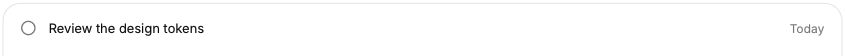

# Swipe actions

Reveal actions next to a list row without taking up space in its resting layout. Available in **GUI**.




## Example

```pascal
unit Docs.Ui.Actions.SwipeActions;

uses Fpas.Ui.Elements as E;
uses Fpas.Ui.Styles as Style;
uses Fpas.Ui.Widgets.Actions.SwipeActions as S;

// Builds the example view.
// ## Returns
// The widget with its message type.
public function View(): E.Element of int;
begin
  return S.SwipeItem of int('task', E.Text of int('Review the design tokens'), [],
    [new S.Item('Archive', Tone := Style.Tone.Info)],
    function(At: S.Side; Index: int): int => Index);
end function;

end unit;
```

## Options and defaults

| Option | Default or requirement |
| --- | --- |
| `Id` | Stable row ID. Assign a different ID to each repeated row. |
| `Content` | Foreground view in a native horizontal row. |
| `Left / Right` | Ordered actions on each side. Either list can be empty. The left side accepts up to 100 actions. |
| `Item.Label` | Optional caption. Pass null to omit it. |
| `Item.Icon` | Null. Supply a CUI glyph to show it above the caption. |
| `Item.Tone` | Neutral. Sets the action tile's color. |
| `Options.Icon / Options.Detail` | Both empty. Supply a leading glyph or a trailing annotation for the foreground. |
| `Options.Enabled` | true. Set to false to close the row and stop gesture input. |

## Interaction

Drag the row sideways with the pointer or scroll horizontally over it. Moving
right reveals the left actions. Moving left reveals the right actions. A long
swipe selects the first action on that side. Select an exposed tile or click
elsewhere to close the row. The callback receives the side and zero-based
index when an action is chosen.

Use `ItemId` to inspect a revealed action. Provide a separate control for
keyboard access to the same commands.

## See also

- [CUI widget inventory](../../../cui-widget-inventory.md#cui_swipe_item_begin)
- [Widget API and types](../../../../src/Fpas.Ui/Widgets/Actions/SwipeActions.fpas)
- [Gallery example](../../../../examples/ui/gui/gallery/Pages/Actions/Widgets/SwipeActions.fpas)
- [Actions](README.md)

## Source files

- `src/Fpas.Ui.Gui/Internal/Widgets/Actions/`
  - [SwipeItem.fpas](../../../../src/Fpas.Ui.Gui/Internal/Widgets/Actions/SwipeItem.fpas)
- `src/Fpas.Ui.Gui.Cui/Interop/Actions/`
  - [NativeMethods.SwipeItem.cs](../../../../src/Fpas.Ui.Gui.Cui/Interop/Actions/NativeMethods.SwipeItem.cs)
- `src/Fpas.Ui.Gui.Cui/Widgets/Actions/`
  - [CuiWindow.SwipeItem.cs](../../../../src/Fpas.Ui.Gui.Cui/Widgets/Actions/CuiWindow.SwipeItem.cs)
- `src/Fpas.Ui.Gui.Cui/native/tests/`
  - [swipe_wheel.c](../../../../src/Fpas.Ui.Gui.Cui/native/tests/swipe_wheel.c)
- `src/Fpas.Ui.Gui.Cui/native/widgets/actions/`
  - [swipe_item.c](../../../../src/Fpas.Ui.Gui.Cui/native/widgets/actions/swipe_item.c)
  - [swipe_item.h](../../../../src/Fpas.Ui.Gui.Cui/native/widgets/actions/swipe_item.h)
