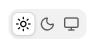

# Theme switcher

Select Light, Dark or an application-provided System appearance. Available in **GUI**.



## Example

```pascal
unit Docs.Ui.Actions.ThemeSwitcher;

uses Fpas.Ui.Elements as E;
uses Fpas.Ui.Widgets.Theming.ThemeSwitchers as T;
uses Fpas.Ui.Widgets.Theming.Themes as Palette;

// Builds the example view.
// ## Parameters
// - `Selected`: Current application value.
// ## Returns
// The widget with its message type.
public function View(Selected: T.Selection): E.Element of T.Selection;
begin
  return T.ThemeSwitcher of T.Selection('theme', Selected,
    function(Choice: T.Selection): T.Selection => Choice, new T.Options(WithSystem := true));
end function;

// Resolves the selected palette for the host's ThemeFor callback.
// ## Parameters
// - `Selected`: The appearance selected in the model.
// - `SystemAppearance`: The concrete light or dark system appearance.
// - `Accent`: The current accent.
// ## Returns
// The theme drawn by the host.
public function ThemeFor(
  Selected: T.Selection; SystemAppearance: Palette.Mode; Accent: Palette.Accent
): Palette.Theme;
begin
  return if T.Resolve(Selected, SystemAppearance) = Palette.Mode.Dark then
    Palette.Dark(Accent)
  else
    Palette.Light(Accent)
  end if;
end function;

end unit;
```

## Options and defaults

| Option | Default or requirement |
| --- | --- |
| `WithSystem / Enabled` | false / true |
| `Selected` | The model supplies the current selection. System requires WithSystem. |

## Interaction

Tab moves focus without selecting. Arrows propose the adjacent choice.
Click, Enter or Space proposes a different selection. Apply the resolved
appearance through ThemeFor. For System, pass the application's concrete OS
appearance to Resolve.

## See also

- [Widget API and types](../../../../src/Fpas.Ui/Widgets/Theming/ThemeSwitchers.fpas)
- [Gallery example](../../../../examples/ui/gui/gallery/Pages/Actions/Widgets/ThemeSwitcher.fpas)
- [Gallery theme callback](../../../../examples/ui/gui/gallery/App/Update.fpas)
- [Sidebar appearance controls](../navigation/sidebar.md#appearance-controls)
- [Actions](README.md)

## Source files

- [ThemeSwitcher.fpas](../../../../src/Fpas.Ui.Gui/Internal/Widgets/Theming/ThemeSwitcher.fpas)
- [CuiWindow.ThemeSwitcher.cs](../../../../src/Fpas.Ui.Gui.Cui/Widgets/Theming/CuiWindow.ThemeSwitcher.cs)
- [CuiThemeSwitcherTests.cs](../../../../tests/Fpas.Ui.Gui.Cui.Tests/Actions/CuiThemeSwitcherTests.cs)
