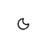

# Theme toggle

Switch between two concrete appearances with a single button. Available in **GUI**.



## Example

```pascal
unit Docs.Ui.Actions.ThemeToggle;

uses Fpas.Ui.Elements as E;
uses Fpas.Ui.Widgets.Theming.ThemeToggles as T;
uses Fpas.Ui.Widgets.Theming.Themes as Themes;

// Builds the example view.
// ## Parameters
// - `Mode`: Current application value.
// ## Returns
// The widget with its message type.
public function View(Mode: Themes.Mode): E.Element of Themes.Mode;
begin
  return T.ThemeToggle of Themes.Mode('appearance', Mode,
    function(Choice: Themes.Mode): Themes.Mode => Choice);
end function;

end unit;
```

## Options and defaults

| Option | Default or requirement |
| --- | --- |
| `Id` | Nonempty stable control ID. |
| `Appearance` | Light or Dark from the model. Resolve System before passing the value. |
| `OnChange` | Maps the proposed opposite appearance to a message. |
| `Enabled` | True. False disables focus and input. |

## Interaction

Click, Enter or Space proposes the opposite appearance. Pass the concrete
value the user currently sees. Apply the accepted change through `ThemeFor`.
CUI shows a sun or moon icon and a tooltip for the target appearance. The
control keeps keyboard focus when the icon and tooltip change.

## See also

- [CUI widget inventory](../../../cui-widget-inventory.md#cui_theme_toggle)
- [Widget API and types](../../../../src/Fpas.Ui/Widgets/Theming/ThemeToggles.fpas)
- [Gallery example](../../../../examples/ui/gui/gallery/Pages/Actions/Widgets/ThemeSwitcher.fpas)
- [Actions](README.md)

## Source files

- [ThemeToggle.fpas](../../../../src/Fpas.Ui.Gui/Internal/Widgets/Theming/ThemeToggle.fpas)
- [CuiWindow.ThemeToggle.cs](../../../../src/Fpas.Ui.Gui.Cui/Widgets/Theming/CuiWindow.ThemeToggle.cs)
- [CuiThemeToggleTests.cs](../../../../tests/Fpas.Ui.Gui.Cui.Tests/Actions/CuiThemeToggleTests.cs)
