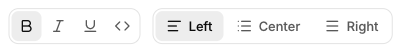

# Toggle group

Group independent flags such as text formatting or exclusive choices such as alignment.



## Example

```pascal
unit Docs.Ui.Actions.ToggleGroup;

uses Fpas.Ui.Elements as E;
uses Fpas.Ui.Widgets.Actions.ToggleGroups as T;

// Builds the example view.
// ## Parameters
// - `Selected`: Current application value.
// ## Returns
// The widget with its message type.
public function View(Selected: array of bool): E.Element of array of bool;
begin
  return T.ToggleGroup of array of bool('format', [new T.Item('Bold'), new T.Item('Italic')],
    Selected, function(Flags: array of bool): array of bool => Flags);
end function;

end unit;
```

## Options and defaults

| Option | Default or requirement |
| --- | --- |
| `Items` | Supply one through 32 items in stable order. Each item needs a single-line label and can include an icon. |
| `Exclusive` | false. When true, selecting a different item clears the other flags. |
| `IconOnly` | false. When true, items with icons use their labels as tooltips. Items without icons keep their visible labels. |
| `ControlSize` | Medium. Small and Large are also available. |
| `Enabled` | true. Set to false to block input and remove the items from the Tab order. |

## Interaction

Pass one selected flag per item. Exclusive mode requires exactly one selected
item. Tab visits enabled items. Left and Right move to the previous or next
item. Click, Enter, or Space proposes a fresh array when the flags change. Keep
the array in the model after accepting a proposal.

An icon-only item's label follows the native tooltip text rules. [Tooltip](../overlays/tooltip.md#options-and-defaults)

## See also

- [CUI widget inventory](../../../cui-widget-inventory.md#cui_toggle_group)
- [Widget API and types](../../../../src/Fpas.Ui/Widgets/Actions/ToggleGroups.fpas)
- [Gallery example](../../../../examples/ui/gui/gallery/Pages/Actions/Widgets/ToggleGroup.fpas)
- [Actions](README.md)

## Source files

- `src/Fpas.Ui.Gui/Internal/Widgets/Actions/`
  - [ToggleGroup.fpas](../../../../src/Fpas.Ui.Gui/Internal/Widgets/Actions/ToggleGroup.fpas)
- `src/Fpas.Ui.Gui.Cui/Interop/Actions/`
  - [NativeMethods.ToggleGroup.cs](../../../../src/Fpas.Ui.Gui.Cui/Interop/Actions/NativeMethods.ToggleGroup.cs)
- `src/Fpas.Ui.Gui.Cui/Widgets/Actions/`
  - [CuiWindow.ToggleGroup.cs](../../../../src/Fpas.Ui.Gui.Cui/Widgets/Actions/CuiWindow.ToggleGroup.cs)
- `src/Fpas.Ui.Gui.Cui/native/widgets/actions/`
  - [toggle_group.c](../../../../src/Fpas.Ui.Gui.Cui/native/widgets/actions/toggle_group.c)
  - [toggle_group.h](../../../../src/Fpas.Ui.Gui.Cui/native/widgets/actions/toggle_group.h)
- `tests/Fixtures/gui-host/`
  - [ToggleGroupContract.fpas](../../../../tests/Fixtures/gui-host/ToggleGroupContract.fpas)
- `tests/Fpas.Ui.Gui.Cui.Tests/Actions/`
  - [CuiToggleGroupTests.cs](../../../../tests/Fpas.Ui.Gui.Cui.Tests/Actions/CuiToggleGroupTests.cs)
