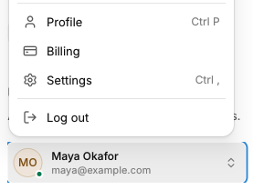

# User menu

Put account commands behind a trigger that shows the user name and initials. Available in **GUI**.



## Example

```pascal
unit Docs.Ui.Actions.UserMenu;

uses Fpas.Ui.Elements as E;
uses Fpas.Ui.Widgets.Overlays.Menus as M;
uses Fpas.Ui.Widgets.Overlays.UserMenus as U;

// Builds the example view.
// ## Returns
// The widget with its message type.
public function View(): E.Element of string;
begin
  return U.UserMenu of string('account', 'Maya Okafor', [
    (M.Entry of string).Action(new M.Item of string('settings', 'Settings', 'settings')),
    (M.Entry of string).Action(new M.Item of string('logout', 'Log out', 'logout'))
  ], new U.Options(Detail := 'maya@example.com'));
end function;

end unit;
```

## Options and defaults

| Option | Default or requirement |
| --- | --- |
| `Detail / Status` | Both empty |
| `AvatarPath` | Null uses initials. A PNG/JPEG path supplies the native trigger and popup image. Failed loads use initials. |
| `Compact / Enabled` | false / true |
| `Position / Width` | BottomStart / 0 for automatic width |

## Interaction

Click, Enter or Space opens the menu. Select an enabled command to send its
message. Escape dismisses the popup and returns focus to the trigger. Use
the same keyed command entries as a dropdown menu.

## See also

- [CUI widget inventory](../../../cui-widget-inventory.md#cui_user_menu)
- [Widget API and types](../../../../src/Fpas.Ui/Widgets/Overlays/UserMenus.fpas)
- [Gallery example](../../../../examples/ui/gui/gallery/Pages/Actions/Widgets/UserMenu.fpas)
- [Actions](README.md)

## Source files

- `src/Fpas.Ui.Gui/Internal/Widgets/Overlays/`
  - [UserMenu.fpas](../../../../src/Fpas.Ui.Gui/Internal/Widgets/Overlays/UserMenu.fpas)
- `src/Fpas.Ui.Gui.Cui/Interop/Overlays/`
  - [NativeMethods.UserMenu.cs](../../../../src/Fpas.Ui.Gui.Cui/Interop/Overlays/NativeMethods.UserMenu.cs)
- `src/Fpas.Ui.Gui.Cui/Widgets/Overlays/`
  - [CuiWindow.UserMenu.cs](../../../../src/Fpas.Ui.Gui.Cui/Widgets/Overlays/CuiWindow.UserMenu.cs)
- `src/Fpas.Ui.Gui.Cui/native/widgets/overlays/`
  - [user_menu.c](../../../../src/Fpas.Ui.Gui.Cui/native/widgets/overlays/user_menu.c)
  - [user_menu.h](../../../../src/Fpas.Ui.Gui.Cui/native/widgets/overlays/user_menu.h)
