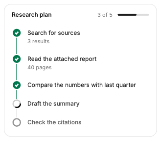

# Agent plan

The gallery shows a research plan with completed, running and pending steps.
Available in **GUI**.



## Example

```pascal
unit Docs.Ui.Ai.AgentPlan;

uses Fpas.Ui.Elements as E;
uses Fpas.Ui.Widgets.Ai.AgentPlans as W;

// Shows the current research plan.
// ## Parameters
// - `Steps`: Ordered steps with their current states.
// ## Returns
// The plan with selected step indices as messages.
public function View(Steps: array of W.Step): E.Element of int;
begin
  return W.AgentPlan of int('research-plan', Steps, function(Index: int): int => Index,
    new W.Options(Title := 'Research plan'));
end function;

end unit;
```

## Options and defaults

| Option | Default or requirement |
| --- | --- |
| `Step.Title` | Supply the step title. |
| `Step.Detail` | null. Supply text to show a supporting line. Failed steps show this line in the danger color. |
| `Step.Status` | Pending. Also accepts Running, Done, Failed and Skipped. |
| `Title` | null displays "Plan". Pass an empty string for a blank heading. |
| `Enabled` | true. |
| `Changed` | Pass a mapper to handle step activation, or null for a passive plan. |

## Interaction

Update each step in the model as work progresses. The progress count includes
Done and Skipped. Running steps use the native motion effects and respect
reduced motion.

Click a row to send its zero-based index when activation is enabled. The
plan rows only accept pointer input.

## See also

- [CUI widget inventory](../../../cui-widget-inventory.md#cui_agent_plan)
- [Widget API and types](../../../../src/Fpas.Ui/Widgets/Ai/AgentPlans.fpas)
- [Gallery example](../../../../examples/ui/gui/gallery/Pages/Ai/View.fpas)
- [AI](README.md)

## Source files

- `src/Fpas.Ui.Gui/Internal/Widgets/Ai/`
  - [AgentPlan.fpas](../../../../src/Fpas.Ui.Gui/Internal/Widgets/Ai/AgentPlan.fpas)
- `src/Fpas.Ui.Gui.Cui/Interop/Ai/`
  - [NativeMethods.AgentPlan.cs](../../../../src/Fpas.Ui.Gui.Cui/Interop/Ai/NativeMethods.AgentPlan.cs)
- `src/Fpas.Ui.Gui.Cui/Widgets/Ai/`
  - [CuiWindow.AgentPlan.cs](../../../../src/Fpas.Ui.Gui.Cui/Widgets/Ai/CuiWindow.AgentPlan.cs)
- `src/Fpas.Ui.Gui.Cui/native/widgets/ai/`
  - [agent_plan.c](../../../../src/Fpas.Ui.Gui.Cui/native/widgets/ai/agent_plan.c)
  - [agent_plan.h](../../../../src/Fpas.Ui.Gui.Cui/native/widgets/ai/agent_plan.h)
- [Native AI card tests](../../../../src/Fpas.Ui.Gui.Cui/native/tests/ai_cards.c)
