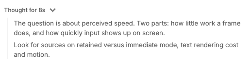

# Reasoning panel

The gallery shows an expandable reasoning panel and changes its heading
while a reply is in progress.
Available in **GUI**.



## Example

```pascal
unit Docs.Ui.Ai.Reasoning;

uses Fpas.Ui.Elements as E;
uses Fpas.Ui.Widgets.Ai.Reasonings as W;

// Shows the current reasoning summary.
// ## Parameters
// - `Summary`: Application-supplied summary.
// - `Thinking`: Whether generation is running.
// - `Seconds`: Elapsed seconds.
// ## Returns
// The native disclosure panel.
public function View(Summary: string; Thinking: bool; Seconds: float): E.Element of string;
begin
  return W.Reasoning of string('reasoning', [E.Text of string(Summary)],
    new W.Options(Thinking := Thinking, Seconds := Seconds));
end function;

end unit;
```

## Options and defaults

| Option | Default or requirement |
| --- | --- |
| `Children` | Supply the view elements to draw inside the panel. |
| `Thinking` | false. Set true to show the running state. |
| `Seconds` | 0. CUI adds the elapsed time to the default heading at one second or more. |
| `Title` | Empty. Supply text to replace the default heading. |
| `Enabled` | true. Set false to disable the heading control. |

## Interaction

Click the heading, or focus it and press Enter or Space, to toggle the panel.
CUI opens the panel while thinking and closes it when thinking ends. If the user
toggles the panel, CUI keeps that choice while the panel stays mounted.
Keep the summary and elapsed time in the application model.

Declare dialogs, sheets, command palettes and file pickers outside the reasoning
body. Validation rejects these modal declarations inside the body even when
they are closed, because CUI owns its disclosure state.

## See also

- [CUI widget inventory](../../../cui-widget-inventory.md#cui_reasoning_begin)
- [Widget API and types](../../../../src/Fpas.Ui/Widgets/Ai/Reasonings.fpas)
- [Gallery example](../../../../examples/ui/gui/gallery/Pages/Ai/View.fpas)
- [AI](README.md)

## Source files

- `src/Fpas.Ui.Gui/Internal/Widgets/Ai/`
  - [Reasoning.fpas](../../../../src/Fpas.Ui.Gui/Internal/Widgets/Ai/Reasoning.fpas)
- `src/Fpas.Ui.Gui.Cui/Interop/Ai/`
  - [NativeMethods.Reasoning.cs](../../../../src/Fpas.Ui.Gui.Cui/Interop/Ai/NativeMethods.Reasoning.cs)
- `src/Fpas.Ui.Gui.Cui/Widgets/Ai/`
  - [CuiWindow.Reasoning.cs](../../../../src/Fpas.Ui.Gui.Cui/Widgets/Ai/CuiWindow.Reasoning.cs)
- `src/Fpas.Ui.Gui.Cui/native/widgets/ai/`
  - [reasoning.c](../../../../src/Fpas.Ui.Gui.Cui/native/widgets/ai/reasoning.c)
  - [reasoning.h](../../../../src/Fpas.Ui.Gui.Cui/native/widgets/ai/reasoning.h)
